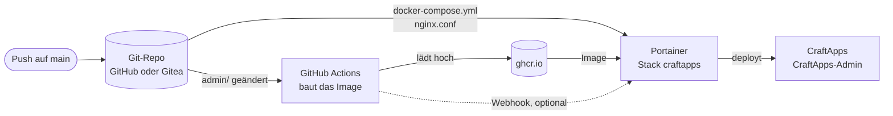
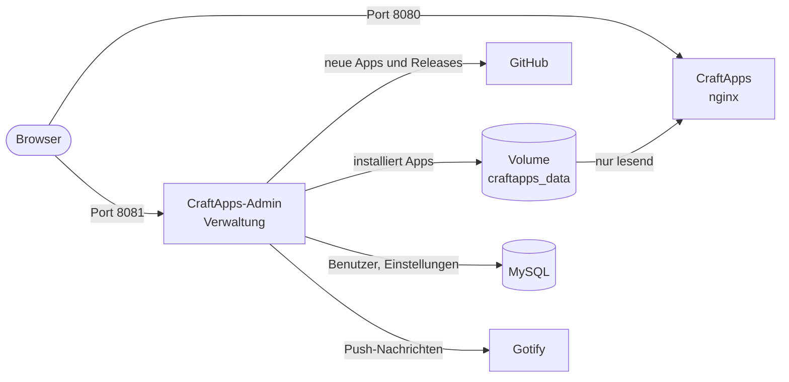
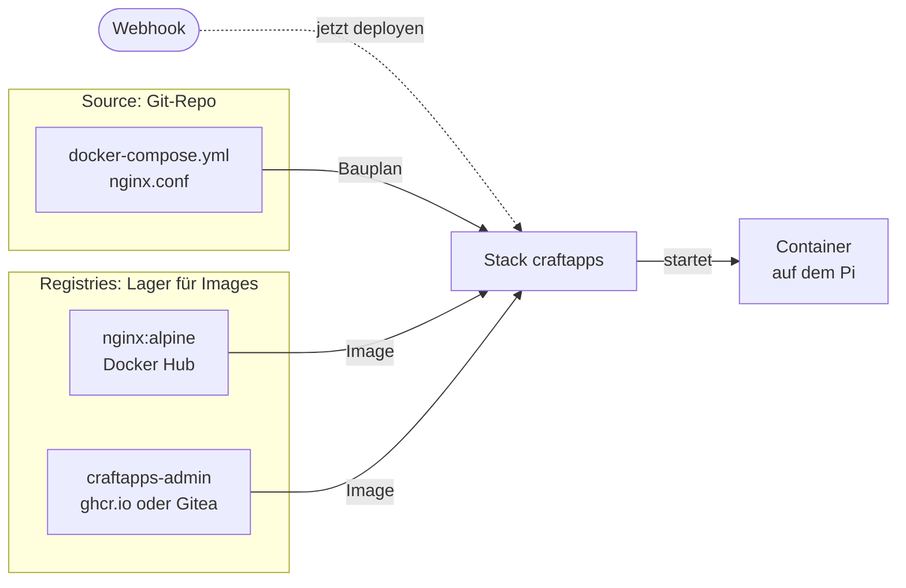
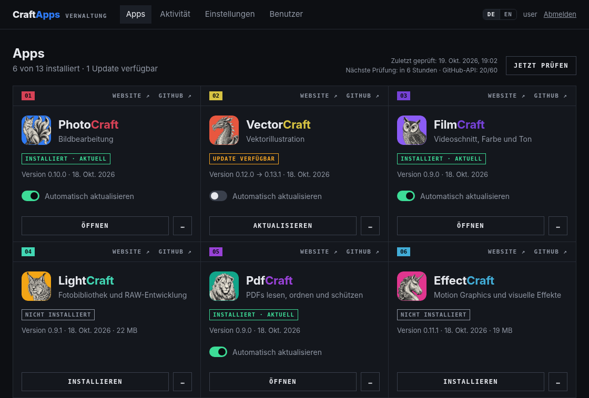
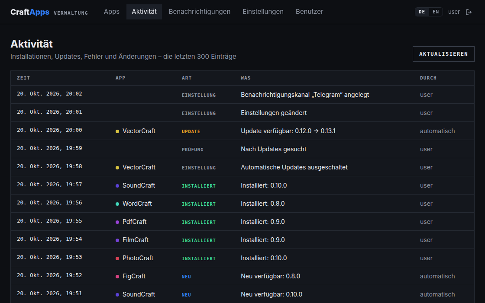
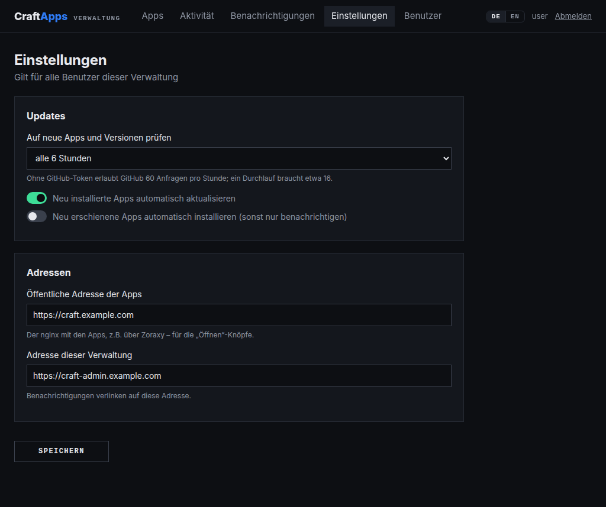
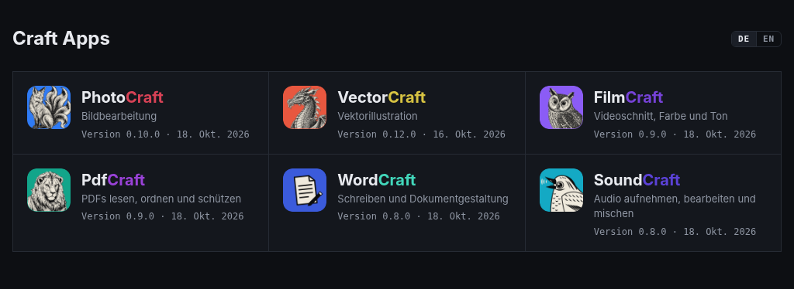
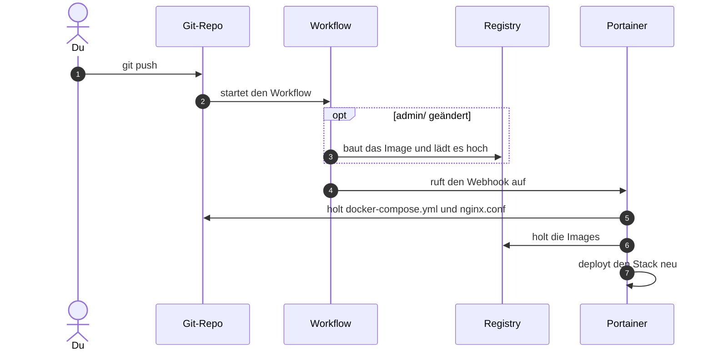
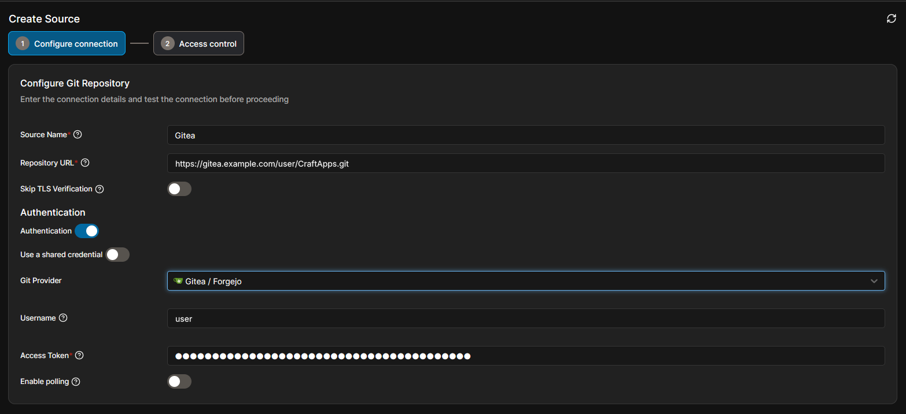
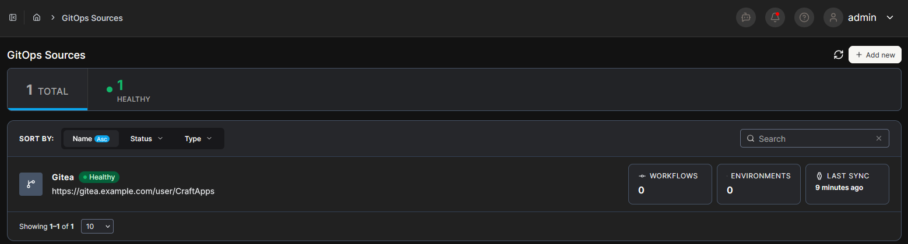

# CraftApps

[English](README.md) | **Deutsch**

Selbst gehostete Web-Versionen der Craft-Apps von [storytold](https://github.com/storytold)
(PhotoCraft, VectorCraft, FilmCraft, …) auf dem Raspberry Pi, mit einer Verwaltung im Stil
des Craft Launchers:

- **nginx** liefert die installierten Apps aus (`/photocraft/`, `/vectorcraft/`, …) und
  zeigt unter `/` eine Übersicht.
- **Die Verwaltung** (Node.js/TypeScript) zeigt alle verfügbaren Apps, installiert und
  entfernt sie, spielt Updates automatisch oder per Knopf ein und meldet alles über Gotify.
  Ihre Oberfläche gibt es auf Deutsch und Englisch.

## Inhalt

- [Aufbau](#aufbau)
- [So greift alles ineinander](#so-greift-alles-ineinander)
- [Was die Verwaltung kann](#was-die-verwaltung-kann)
- [Einrichtung](#einrichtung)
- [Im Betrieb](#im-betrieb)
- [Benachrichtigungen](#benachrichtigungen)
- [Gut zu wissen](#gut-zu-wissen)
- [Entwicklung](#entwicklung)
- [Container](#container)
- [Fehlersuche](#fehlersuche)

## Aufbau

```text
CraftApps\
├── .gitea\workflows\admin-image.yaml   Baut das Image zusätzlich in Gitea (optional)
├── .github\workflows\admin-image.yaml  Baut das Image der Verwaltung (ARM64) nach ghcr.io, wenn sich admin\ ändert
├── .vscode\                            Starten und Debuggen in VS Code, empfohlene Erweiterungen
├── admin\                              Verwaltung: Fastify-Server und React-Oberfläche
│   ├── Dockerfile
│   ├── public\                         Tab-Icons: Verwaltung, overview\ für die Startseite
│   └── src\
│       ├── server\                     Fastify-Server, main.ts startet ihn
│       │   ├── api\                    Routen für die Verwaltung
│       │   ├── apps\                   Apps finden, installieren und aktualisieren; Startseite
│       │   ├── auth\                   Benutzer, Sitzungen, Anmeldung
│       │   ├── core\                   Konfiguration, Datenbank, Hilfsfunktionen
│       │   ├── notify\                 Benachrichtigungen über Gotify
│       │   └── settings\               Einstellungen
│       ├── shared\                     Typen und Meldungen (Deutsch/Englisch) für Server und Oberfläche
│       └── web\                        React-Oberfläche, main.tsx startet sie
│           ├── App\                    Kopfzeile und Tabs
│           ├── components\             AppCard, LangSwitch, Toggle – jeweils mit ihren Styles
│           ├── i18n\                   Sprache und Texte, Deutsch und Englisch in locales\
│           ├── lib\                    API-Aufrufe und Formatierung
│           ├── pages\                  Apps, Aktivität, Einstellungen, Benutzer, Anmeldung – jeweils mit Styles
│           └── styles\                 Globales SCSS; index.scss lädt alle Styles
├── dev.sh                              Startet MySQL, Verwaltung und Startseite für einen lokalen Test
├── docker-compose.dev.yml              MySQL für die lokale Entwicklung
├── docker-compose.yml                  Stack für Portainer: nginx und Verwaltung
├── docs\images\                        Screenshots für diese README
└── nginx.conf                          Konfiguration des nginx
```

## So greift alles ineinander

Vom Push bis zu den laufenden Containern:



Von Änderungen erfährt Portainer auf einem von zwei Wegen:

|                                                    | Polling und Watchtower (Standard)           | Webhook ([Schritt 6](#6-deploy-nach-dem-build-optional)) |
| -------------------------------------------------- | ------------------------------------------- | -------------------------------------------------------- |
| Änderung an `docker-compose.yml` oder `nginx.conf` | Portainer prüft das Repo alle 5 Minuten     | Der Workflow ruft Portainer direkt nach dem Push auf     |
| Neues Image der Verwaltung                         | Watchtower holt es bei seinem nächsten Lauf | Portainer holt es direkt nach dem Build                  |
| Voraussetzung                                      | Watchtower                                  | Portainer ist vom Runner des Workflows aus erreichbar    |

Zur Laufzeit:



- Standardmäßig sind Apps und Verwaltung nur im lokalen Netz über die Ports des Pi
  erreichbar. Öffentlich mit eigenen Domains und HTTPS macht sie ein Reverse Proxy wie
  Zoraxy, siehe [Schritt 5](#5-https-mit-reverse-proxy-optional).
- Portainer kann Images aus einem Git-Repo nicht selbst bauen
  ([Portainer-FAQ](https://docs.portainer.io/2.39-lts/faqs/troubleshooting/stacks-deployments-and-updates/can-i-build-an-image-while-deploying-a-stack-application-from-git)).
  Deshalb baut GitHub Actions das Image, und die Compose-Datei verweist nur darauf.
- Liegt das Repo in Gitea, spiegelt Gitea es nach GitHub. Zusätzlich kann Gitea Actions das
  Image in die Gitea-Registry bauen, siehe [Image selbst bauen](#image-selbst-bauen).
- `nginx.conf` kommt per Bind-Mount direkt aus dem Repo. Das geht nur mit
  „Enable relative path volumes“ der Portainer Business Edition
  ([Portainer-Doku](https://docs.portainer.io/advanced/relative-paths)).
- nginx ist das offizielle Image `nginx:alpine`. Aktuell hält es Watchtower oder der Deploy
  per Webhook.

### Begriffe in Portainer

Portainer holt zwei Dinge von zwei Orten: den Bauplan aus dem Git-Repo und die fertigen
Images aus Registries. Der Stack führt beides zusammen:



| Begriff             | Was es ist                                                                   | Wo in Portainer                                       | Nötig                                                  |
| ------------------- | ---------------------------------------------------------------------------- | ----------------------------------------------------- | ------------------------------------------------------ |
| **Source**          | Das Git-Repo mit `docker-compose.yml` und `nginx.conf`, samt Token zum Lesen | **Sources** im linken Menü                            | ja                                                     |
| **Stack**           | Startet die Container so, wie es `docker-compose.yml` beschreibt             | **Stacks → Add stack**                                | ja                                                     |
| **Registry**        | Zugangsdaten für ein Lager mit Images, das eine Anmeldung verlangt           | **Registries**, je nach Version **Host → Registries** | nur für ein Image, das nicht öffentlich ist            |
| **Webhook**         | Adresse des Stacks, die Portainer deployen lässt                             | im Stack bei **GitOps updates**                       | nur für [Schritt 6](#6-deploy-nach-dem-build-optional) |
| **GitOps Workflow** | Verteilt Stacks auf Edge-Gruppen                                             | **Workflows**                                         | nein, ist für Edge-Umgebungen gedacht                  |

Öffentliche Images wie `nginx:alpine` oder das fertige Image der Verwaltung brauchen keinen
Registry-Eintrag.

## Was die Verwaltung kann

- **Apps** im Raster wie der Craft Launcher – mit dessen Icons, Markenfarben und
  Kurzbeschreibungen: installieren, aktualisieren, neu installieren, deinstallieren,
  automatische Updates je App an- oder ausschalten.
- **Neue Apps** findet sie selbst: alle Repos von storytold, die auf `craft` enden und
  deren neuestes Release ein `<app>-web-*.zip` hat. Neue Apps werden gemeldet und auf
  Wunsch automatisch installiert.
- **Updates ohne Unterbrechung:** Neue Dateien kommen neben die alten, `index.html` wird
  zuletzt umgeschaltet, die Vorversion bleibt bis zum nächsten Update liegen. Jeder
  Download wird per SHA-256 geprüft.
- **Anmeldung** mit Benutzern in MySQL, Aktivitätsverlauf, Einstellungen (Prüfintervall,
  Gotify, Adressen) und Benutzerverwaltung.
- **Push-Nachrichten** über Gotify, siehe [Benachrichtigungen](#benachrichtigungen).
- **Deutsch und Englisch:** Die Verwaltung richtet sich nach der Sprache des Browsers und
  hat oben einen Umschalter, ebenso die Startseite unter `/`. Die Gotify-Nachrichten folgen
  der Sprache aus den Einstellungen.

Daten: Benutzer, Einstellungen und Verlauf liegen in MySQL, die Apps im Volume
`craftapps_data`, das nginx nur lesend einbindet.

### Screenshots

**Apps:** eine Karte je App – hier installiert, mit wartendem Update (automatische Updates
aus) und noch nicht installiert:



**Aktivität:** was passiert ist, automatisch oder durch welchen Benutzer:



**Einstellungen:** Prüfintervall, Adressen und Gotify:



**Startseite** unter `/`: die installierten Apps, ausgeliefert von nginx:



## Einrichtung

Die Schritte bauen aufeinander auf. Wie die einzelnen Container eingerichtet werden, steht
gesammelt unter [Container](#container); die Schritte verweisen an der passenden Stelle
dorthin. Das Image der Verwaltung gibt es fertig als
`ghcr.io/pr0gh4nt3r/craftapps-admin:latest`, selbst bauen musst du es nicht.

In Adressen, Befehlen und Vorlagen stehen Platzhalter für deine Werte:

| Platzhalter          | Bedeutung                                     | Beispiel                                    |
| -------------------- | --------------------------------------------- | ------------------------------------------- |
| `<host>`             | Adresse des Pi im lokalen Netz                | `192.168.1.10`                              |
| `<repo-url>`         | Adresse des Repos zum Klonen                  | `https://github.com/benutzer/CraftApps.git` |
| `<apps-domain>`      | Domain für die Apps                           | `craft.example.com`                         |
| `<admin-domain>`     | Domain für die Verwaltung                     | `craft-admin.example.com`                   |
| `<portainer-domain>` | Öffentliche Domain von Portainer              | `portainer.example.com`                     |
| `<github-konto>`     | Dein GitHub-Konto, klein geschrieben          | `benutzer`                                  |
| `<gitea-host>`       | Adresse deiner Gitea-Instanz, ohne `https://` | `gitea.example.com`                         |
| `<besitzer>`         | Konto in Gitea, dem das Repo gehört           | `benutzer`                                  |

Die Domains brauchst du nur für
[HTTPS mit Reverse Proxy](#5-https-mit-reverse-proxy-optional) und
[Schritt 6](#6-deploy-nach-dem-build-optional), die letzten drei nur, wenn du das
[Image selbst baust](#image-selbst-bauen).

### Überblick

| Schritt                                  | Was du tust                                  | Wo                          | Nötig    |
| ---------------------------------------- | -------------------------------------------- | --------------------------- | -------- |
| [1](#1-datenbank-anlegen)                | Datenbank und Benutzer anlegen               | MySQL                       | ja       |
| [2](#2-datenbank-erreichbar-machen)      | Festlegen, wie die Verwaltung MySQL erreicht | MySQL, `docker-compose.yml` | ja       |
| [3](#3-stack-in-portainer-anlegen)       | Repo als Source anlegen, Stack anlegen       | Portainer                   | ja       |
| [4](#4-erste-anmeldung)                  | Anmelden, Adressen und Gotify eintragen      | Verwaltung                  | ja       |
| [5](#5-https-mit-reverse-proxy-optional) | Eigene Domains mit HTTPS                     | Reverse Proxy               | optional |
| [6](#6-deploy-nach-dem-build-optional)   | Direkt nach dem Build deployen               | Portainer, Repo             | optional |

### Voraussetzungen

- **Raspberry Pi** mit 64-Bit-System und Docker. Das Image der Verwaltung gibt es nur für
  ARM64.
- **Portainer Business Edition.** Nur sie kann `nginx.conf` direkt aus dem Repo einbinden
  („Enable relative path volumes“). Diese README folgt der aktuellen Oberfläche mit
  **Sources**; in älteren Versionen stehen die Angaben zum Repo direkt im Formular des
  Stacks.
- **Ein Git-Repo mit diesem Projekt,** aus dem Portainer den Stack holt: das öffentliche
  auf GitHub oder ein eigenes, z.B. ein Fork oder ein Repo in Gitea.
- **Auf dem Pi** MySQL und Watchtower, optional Zoraxy und Gotify. Watchtower entfällt,
  wenn Portainer nach dem Build per Webhook deployt (Schritt 6). Was CraftApps von ihnen
  braucht – und Vorlagen, falls etwas davon fehlt –, steht unter [Container](#container).

### Tokens und Secrets auf einen Blick

Welche du davon brauchst, hängt von deinem Aufbau ab – mit dem öffentlichen Repo und dem
fertigen Image gar keine. Gib jedem Token nur die Rechte aus dieser Tabelle.

| Token                  | Wofür                                                                             | Rechte                                                       | Anlegen in                                                         | Eintragen in                                                                         |
| ---------------------- | --------------------------------------------------------------------------------- | ------------------------------------------------------------ | ------------------------------------------------------------------ | ------------------------------------------------------------------------------------ |
| Repo-Token, Gitea      | Portainer liest das Repo, falls es nicht öffentlich ist                           | **repository: Lesen**, **user: Lesen**                       | Gitea: **Einstellungen → Anwendungen**                             | [Source](#craftapps-und-craftapps-admin): **Access Token**                           |
| Repo-Token, GitHub     | dasselbe für ein privates Repo auf GitHub                                         | Fine-grained, **Contents: Read-only**                        | GitHub: **Settings → Developer settings → Personal access tokens** | [Source](#craftapps-und-craftapps-admin): **Access Token**                           |
| Registry-Token, Gitea  | Portainer und Watchtower holen das Image aus Gitea, falls es nicht öffentlich ist | **package: Lesen**                                           | Gitea: **Einstellungen → Anwendungen**                             | [Registry](#registry-in-portainer-optional): **Password**, [Watchtower](#watchtower) |
| Registry-Token, GitHub | Portainer holt ein privates Paket von `ghcr.io`                                   | Classic, **read:packages**                                   | GitHub: **Settings → Developer settings → Personal access tokens** | [Registry](#registry-in-portainer-optional): **Password**                            |
| `REGISTRY_TOKEN`       | der Gitea-Workflow lädt das Image hoch                                            | **package: Lesen und Schreiben**                             | Gitea: **Einstellungen → Anwendungen**                             | Gitea-Repo: **Einstellungen → Actions → Geheimnisse**                                |
| Mirror-Token           | Gitea spiegelt das Repo nach GitHub                                               | Fine-grained, **Contents** und **Workflows: Read and write** | GitHub: **Settings → Developer settings → Personal access tokens** | Gitea-Repo: **Einstellungen → Mirror-Einstellungen**                                 |
| `PORTAINER_WEBHOOK`    | der Workflow stößt den Deploy an                                                  | –                                                            | Portainer: Stack → **GitOps updates → Copy link**                  | Secret im Repo, siehe [Schritt 6](#6-deploy-nach-dem-build-optional)                 |
| Registrierungstoken    | der [Gitea-Runner](#gitea-runner) registriert sich einmalig                       | –                                                            | Gitea-Repo: **Einstellungen → Actions → Runner**                   | Stack `gitea-runner`, danach wieder entfernen                                        |
| `GITHUB_TOKEN`         | die Verwaltung prüft öfter als etwa alle 20 Minuten auf Updates                   | Fine-grained, **Public repositories (read-only)**            | GitHub: **Settings → Developer settings → Personal access tokens** | `docker-compose.yml`, siehe [Gut zu wissen](#gut-zu-wissen)                          |

Repo-Token und Registry-Token für Gitea können auch ein einziger Token mit
**repository: Lesen**, **user: Lesen** und **package: Lesen** sein.

### 1. Datenbank anlegen

Im Container `MySQL`, z.B. in Portainer unter **Containers → MySQL → Console** mit
`mysql -uroot -p`:

```sql
CREATE DATABASE craftapps CHARACTER SET utf8mb4 COLLATE utf8mb4_unicode_ci;
CREATE USER 'craftapps'@'%' IDENTIFIED BY 'ein-langes-passwort';
GRANT ALL PRIVILEGES ON craftapps.* TO 'craftapps'@'%';
```

Mit phpMyAdmin geht es so: unter **Benutzerkonten → Benutzerkonto hinzufügen** den
Benutzernamen `craftapps` eintragen, als Hostname **Jeder Host** (`%`) und als
Authentifizierungs-Plugin **Zwischenspeichern der sha2-Authentifizierung** wählen – den
Standard von MySQL 8. Dazu
**Erstelle eine Datenbank mit gleichem Namen und gewähre alle Rechte.** ankreuzen. Die
beiden anderen Plugins sind veraltet: Die **Native MySQL-Authentifizierung** schaltet
MySQL 8.4 standardmäßig ab, die **SHA256-Passwort-Authentifizierung** ist abgekündigt.

Das Passwort brauchst du in Schritt 3 als `CRAFTAPPS_DB_PASSWORD`. Die Tabellen legt die
Verwaltung beim ersten Start selbst an.

### 2. Datenbank erreichbar machen

Standardmäßig bekommt der Stack sein eigenes Docker-Netz. Die Verwaltung erreicht MySQL
deshalb über die Adresse in `CRAFTAPPS_DB_HOST`, und dafür gibt es zwei Wege:

| Weg                           | `CRAFTAPPS_DB_HOST`                     | Was es braucht                                                                                                            |
| ----------------------------- | --------------------------------------- | ------------------------------------------------------------------------------------------------------------------------- |
| **Über den Pi**               | `<host>`                                | MySQL gibt Port `3306` am Pi frei, wie in der [Vorlage für MySQL](#mysql)                                                 |
| **Über ein gemeinsames Netz** | Name des MySQL-Containers, z.B. `MySQL` | beide Container kommen per Umgebungsvariablen in das Netz von MySQL, siehe [Gemeinsames Netz](#gemeinsames-netz-optional) |

### 3. Stack in Portainer anlegen

In Portainer richtest du bis zu drei Dinge ein, in dieser Reihenfolge:

1. **Source:** das Repo mit `docker-compose.yml`, siehe
   [CraftApps und CraftApps-Admin](#craftapps-und-craftapps-admin).
2. **Registry:** nur für ein Image, das nicht öffentlich ist, siehe
   [Registry in Portainer](#registry-in-portainer-optional). Das fertige Image braucht sie
   nicht.
3. **Stack:** liest `docker-compose.yml` aus der Source und startet die Container,
   ebenfalls unter [CraftApps und CraftApps-Admin](#craftapps-und-craftapps-admin).

Danach laufen die Container `CraftApps` und `CraftApps-Admin`, und im Log der Verwaltung
steht „Benutzer admin angelegt“. Falls nicht, siehe [Fehlersuche](#fehlersuche).

### 4. Erste Anmeldung

`http://<host>:8081` öffnen und mit `admin` und dem Passwort aus
`CRAFTAPPS_ADMIN_PASSWORD` anmelden. Unter **Einstellungen** eintragen:

| Einstellung                      | Ohne Reverse Proxy   | Mit Reverse Proxy        | Wofür                                            |
| -------------------------------- | -------------------- | ------------------------ | ------------------------------------------------ |
| **Öffentliche Adresse der Apps** | `http://<host>:8080` | `https://<apps-domain>`  | die „Öffnen“-Knöpfe                              |
| **Adresse dieser Verwaltung**    | `http://<host>:8081` | `https://<admin-domain>` | öffnet sich beim Antippen einer Benachrichtigung |

Dann **Gotify-Server** und **App-Token** eintragen (siehe [Gotify](#gotify)) und auf
**Testnachricht senden** klicken.

Etwa zehn Sekunden nach dem Start fragt die Verwaltung zum ersten Mal GitHub ab und zeigt
dann alle verfügbaren Apps. Zum Abschluss eine App installieren und unter
`http://<host>:8080` öffnen.

### 5. HTTPS mit Reverse Proxy (optional)

WebGPU und die Zwischenablage erlauben Browser nur in einem sicheren Kontext, also über
HTTPS oder direkt auf `localhost`. Über `http://<host>:8080` laufen die Apps, nur ohne diese
Funktionen. HTTPS und eigene Domains bringt ein Reverse Proxy davor, z.B.
[Zoraxy](#zoraxy) mit Zertifikaten von Let's Encrypt:

| Domain           | Ziel          | Zweck      |
| ---------------- | ------------- | ---------- |
| `<apps-domain>`  | `<host>:8080` | Apps       |
| `<admin-domain>` | `<host>:8081` | Verwaltung |

Danach in den Einstellungen der Verwaltung beide Adressen auf `https://` umstellen.

### 6. Deploy nach dem Build (optional)

Statt per Polling und Watchtower kann Portainer selbst deployen, sobald der Build durch
ist. Die Pipeline ist dann Push → Build → Deploy:



Schlägt der Build fehl, bricht der Workflow vor dem Webhook ab, und die laufende Version
bleibt. Das braucht einen Build in deinem eigenen Repo, siehe
[Image selbst bauen](#image-selbst-bauen): Das fertige Image baut der Workflow im Repo
dieses Projekts, und der weiß nichts von deinem Portainer.

1. **Stack einstellen:** in Portainer im Stack `craftapps` bei **GitOps updates**:

   | Einstellung            | Wert                                                                                          |
   | ---------------------- | --------------------------------------------------------------------------------------------- |
   | **Mechanism**          | **Webhook**                                                                                   |
   | **Re-pull image**      | an – holt die Images bei jedem Deploy neu                                                     |
   | **Force redeployment** | an – sonst deployt Portainer nur nach Änderungen im Repo, ein neues Image allein reicht nicht |
   | Webhook-URL            | mit **Copy link** kopieren                                                                    |

   Für ein Image aus einer Registry mit Anmeldung braucht **Re-pull image** die
   [Registry in Portainer](#registry-in-portainer-optional).

2. **URL prüfen:** **Copy link** nimmt die Adresse, unter der du Portainer geöffnet hast,
   z.B. `https://<host>:9443/api/stacks/webhooks/<id>`. Der Runner muss sie erreichen, und
   bei HTTPS muss das Zertifikat gültig sein, denn der Workflow prüft es:

   | Runner                   | Passende URL                                                                                                                                      |
   | ------------------------ | ------------------------------------------------------------------------------------------------------------------------------------------------- |
   | GitHub, aus dem Internet | `https://<portainer-domain>/api/stacks/webhooks/<id>` über den Reverse Proxy; öffentlich am besten nur den Pfad `/api/stacks/webhooks/` freigeben |
   | Gitea-Runner auf dem Pi  | auch eine Adresse im lokalen Netz, solange sie kein selbstsigniertes Zertifikat hat                                                               |

3. **Secret anlegen:** die URL als Secret `PORTAINER_WEBHOOK` im Repo anlegen, dessen Build
   das Image für den Stack liefert – nur dort, sonst deployt Portainer doppelt:

   | Der Stack nimmt …                 | Secret in      | Menü                                                                   |
   | --------------------------------- | -------------- | ---------------------------------------------------------------------- |
   | dein Image von `ghcr.io`          | im GitHub-Repo | **Settings → Secrets and variables → Actions → New repository secret** |
   | dein Image aus der Gitea-Registry | im Gitea-Repo  | **Einstellungen → Actions → Geheimnisse → Secret hinzufügen**          |

4. **Watchtower für CraftApps abschalten:** im Stack `CRAFTAPPS_WATCHTOWER` auf `false`
   setzen.

Der Workflow ruft die URL als letzten Schritt auf: nach einem erfolgreichen Build und nach
Änderungen an `docker-compose.yml` oder `nginx.conf`, die kein neues Image brauchen. Ohne
das Secret baut der Workflow nur. Wer die URL kennt, kann den Stack neu deployen – sie
gehört deshalb nur in das Secret.

### Image selbst bauen

Nur nötig, wenn du nicht das fertige Image nehmen willst, oder für
[Schritt 6](#6-deploy-nach-dem-build-optional). Im Stack zeigt dann `CRAFTAPPS_ADMIN_IMAGE`
auf dein Image.

|            | Auf GitHub                                                                                 | In Gitea                                                               |
| ---------- | ------------------------------------------------------------------------------------------ | ---------------------------------------------------------------------- |
| Workflow   | [.github/workflows/admin-image.yaml](.github/workflows/admin-image.yaml)                   | [.gitea/workflows/admin-image.yaml](.gitea/workflows/admin-image.yaml) |
| Image      | `ghcr.io/<github-konto>/craftapps-admin`                                                   | `<gitea-host>/<besitzer>/craftapps-admin`                              |
| Baut auf   | den ARM64-Runnern von GitHub                                                               | deinem eigenen [Runner](#gitea-runner), z.B. auf dem Pi                |
| Secrets    | keine                                                                                      | `REGISTRY_TOKEN`                                                       |
| Baut, wenn | sich `admin\` ändert, bei **Run workflow** und montags um 03:17 UTC für Sicherheitsupdates | sich `admin\` ändert und bei **Run workflow**                          |

Beide rufen danach `PORTAINER_WEBHOOK` auf, falls es das Secret gibt, siehe
[Schritt 6](#6-deploy-nach-dem-build-optional).

#### Auf GitHub

Der Workflow baut in jedem GitHub-Repo mit diesem Projekt, etwa einem Fork.

1. In einem Fork die Workflows unter **Actions** einmal erlauben.
2. Unter **Actions → Verwaltung bauen → Run workflow** den ersten Build starten.
3. Das Paket erscheint im Profil unter **Packages** und übernimmt die Sichtbarkeit des
   Repos. Ist es privat, unter **Package settings → Change visibility** auf **Public**
   stellen. Sonst brauchen Portainer und Watchtower Zugangsdaten, siehe
   [Registry in Portainer](#registry-in-portainer-optional).
4. Im Stack `CRAFTAPPS_ADMIN_IMAGE` auf `ghcr.io/<github-konto>/craftapps-admin:latest`
   setzen.

**Spiegel aus Gitea:** Liegt das Repo in Gitea, im Repo unter **Einstellungen** bei
**Mirror-Einstellungen** einen Push-Mirror anlegen: die Adresse des GitHub-Repos, dein
GitHub-Konto und den Mirror-Token als Passwort,
**Synchronisieren, wenn Commits gepusht wurden** an, dann **Push-Mirror hinzufügen**. Der
Mirror-Token braucht **Contents** und **Workflows**, jeweils mit Lesen und Schreiben. Ohne
**Workflows** lehnt GitHub jeden Push ab, der `.github/workflows/` ändert.

#### In Gitea

1. **Actions einschalten:** Actions und Pakete (die Container-Registry) sind in aktuellen
   Gitea-Versionen standardmäßig an. Sonst in der `app.ini` unter `[actions]` und
   `[packages]` jeweils `ENABLED = true` setzen, im Container per
   `GITEA__actions__ENABLED=true` und `GITEA__packages__ENABLED=true`, und Gitea neu
   starten. Fehlt im Repo der Reiter **Actions**, in den **Einstellungen** des Repos
   **Repository-Actions aktivieren** einschalten.
2. **Runner einrichten** wie unter [Gitea-Runner](#gitea-runner) beschrieben, bis er in
   Gitea als online erscheint.
3. **Token für den Build:** in Gitea mit dem Konto `<besitzer>` unter
   **Einstellungen → Anwendungen** einen Token mit **package: Lesen und Schreiben**
   erzeugen, z.B. `craftapps-build`, und ihn im Repo unter
   **Einstellungen → Actions → Geheimnisse** als Secret `REGISTRY_TOKEN` anlegen.
4. **Image bauen:** unter **Actions → Verwaltung bauen → Run workflow**. Der erste Lauf lädt
   das Job-Image des Runners, etwa 0,5 GB. Danach liegt das Image in deinem Gitea-Profil
   unter **Pakete**: `<gitea-host>/<besitzer>/craftapps-admin:latest`. Den Besitzer
   schreibt der Workflow klein, weil Docker in Image-Namen keine Großbuchstaben erlaubt.
5. **Lesezugriff für Portainer und Watchtower,** falls die Pakete nicht öffentlich sind –
   etwa weil deine Gitea-Instanz eine Anmeldung verlangt: einen Token mit
   **package: Lesen** erzeugen, z.B. `pi-lesen`. Portainer bekommt ihn als Registry, siehe
   [Registry in Portainer](#registry-in-portainer-optional), Watchtower als `config.json`,
   siehe [Watchtower](#watchtower).
6. Im Stack `CRAFTAPPS_ADMIN_IMAGE` auf `<gitea-host>/<besitzer>/craftapps-admin:latest`
   setzen.

## Im Betrieb

| Du änderst …         | Polling und Watchtower                                                                                                           | Webhook ([Schritt 6](#6-deploy-nach-dem-build-optional))                            |
| -------------------- | -------------------------------------------------------------------------------------------------------------------------------- | ----------------------------------------------------------------------------------- |
| Code in `admin\`     | GitHub Actions baut ein neues Image, Watchtower spielt es bei seinem nächsten Lauf ein.                                          | Der Workflow baut ein neues Image, danach deployt es Portainer.                     |
| `docker-compose.yml` | Portainer deployt den Stack innerhalb des Polling-Intervalls neu.                                                                | Portainer deployt den Stack direkt nach dem Push neu.                               |
| `nginx.conf`         | Portainer holt die neue Datei innerhalb des Polling-Intervalls. Danach `CraftApps` neu starten – nginx liest sie nur beim Start. | Portainer holt die neue Datei direkt nach dem Push. Danach `CraftApps` neu starten. |
| nichts               | Montags früh baut GitHub Actions neu (Sicherheitsupdates für Node und Alpine), nginx hält Watchtower aktuell.                    | Nach dem Build am Montag auf GitHub deployt Portainer mit frischen Images neu.      |

- **Um nicht zu warten:** in Portainer **Containers → CraftApps-Admin → Recreate** mit
  **Re-pull image**.
- **Ein Build von Hand:** auf GitHub unter **Actions → Verwaltung bauen → Run workflow**.
- **Geplante Läufe** pausiert GitHub, wenn sich 60 Tage lang nichts im Repo tut. Unter
  **Actions** lassen sie sich wieder einschalten.

## Benachrichtigungen

| Ereignis                                                                             | Gotify-Priorität |
| ------------------------------------------------------------------------------------ | ---------------- |
| Neue App verfügbar (beim allerersten Start und ab vier auf einmal als Sammelmeldung) | 5                |
| Update verfügbar – nur für Apps, deren automatische Updates aus sind                 | 5                |
| Update eingespielt (automatisch oder per Knopf), neue App automatisch installiert    | 4                |
| Fehler – jeder Fehler einmal, nicht bei jeder Prüfung erneut                         | 8                |

Jede Kategorie lässt sich in den Einstellungen abschalten; dort wählst du auch die Sprache
der Nachrichten, Deutsch oder Englisch. Antippen öffnet die Verwaltung.

## Gut zu wissen

- Pro Prüfung braucht die Verwaltung etwa 16 Anfragen an die GitHub-API. Ohne Token erlaubt
  GitHub 60 pro Stunde; für Prüfintervalle unter etwa 20 Minuten in `docker-compose.yml`
  `GITHUB_TOKEN` setzen.
- Anmeldung: höchstens 10 Versuche pro 15 Minuten und IP-Adresse.
- Reihenfolge, Namen, Farben, deutsche und englische Texte und Icons übernimmt die
  Verwaltung aus dem [Craft Launcher](https://github.com/storytold/craft-launcher). Ist der
  nicht erreichbar, gilt der zuletzt bekannte Stand.
- Der Container der Verwaltung läuft als Benutzer 1000 mit schreibgeschütztem
  Dateisystem und ohne Linux-Capabilities. Ein neues Volume `craftapps_data` gehört
  automatisch diesem Benutzer. Meldet die Verwaltung trotzdem fehlende Schreibrechte, auf
  dem Pi `sudo chown -R 1000:1000 /var/lib/docker/volumes/craftapps_data/_data` ausführen.

## Entwicklung

Gedacht für Linux oder WSL mit Node.js 24 und Docker. Unter WSL gehört das Repo ins
Linux-Dateisystem (nicht unter `/mnt/c`), sonst bemerkt Vite Änderungen nicht zuverlässig.
Docker läuft dort entweder direkt in der Distribution oder über Docker Desktop mit
eingeschalteter WSL-Integration für die Distribution, aber nicht beides.

Ein Befehl im Hauptordner startet alles für einen lokalen Test, **Strg+C** beendet alles
wieder:

```bash
./dev.sh
```

- **Verwaltung** unter `http://localhost:5173`: Vite zeigt Änderungen an der Oberfläche
  sofort, der Server startet bei Änderungen neu.
- **Startseite** unter `http://localhost:8080`: nginx mit `nginx.conf` wie auf dem Pi,
  liefert `admin/data` aus. Anderer Port: `START_PAGE_PORT=8090 ./dev.sh`.
- Vorher startet das Skript MySQL aus `docker-compose.dev.yml` – und stoppt es am Ende nur,
  wenn es MySQL selbst gestartet hat. Fehlen die Abhängigkeiten oder hat sich
  `package-lock.json` geändert, führt es `npm ci` aus; fehlt `admin/.env`, legt es sie aus
  `.env.example` an.

Anmelden mit `admin` und dem Passwort aus `admin/.env`. Installierte Apps landen in
`admin/data`. Damit die „Öffnen“-Knöpfe zur lokalen Startseite führen, unter
**Einstellungen** bei **Öffentliche Adresse der Apps** `http://localhost:8080` eintragen.

Dasselbe Schritt für Schritt:

```bash
docker compose -f docker-compose.dev.yml up -d   # MySQL for development
cd admin
npm ci
cp .env.example .env                       # once; matches docker-compose.dev.yml
npm run dev:server                         # server, restarts on changes
npm run dev:web                            # second terminal: UI at http://localhost:5173
# third terminal, in the main folder: start page at http://localhost:8080
docker run --rm -p 127.0.0.1:8080:80 \
  -v "$PWD/nginx.conf:/etc/nginx/conf.d/default.conf:ro" \
  -v "$PWD/admin/data:/srv/craftapps:ro" nginx:alpine
```

**Debuggen in VS Code:** den Ordner `CraftApps` selbst öffnen, nicht einen Ordner darüber –
die Startkonfigurationen liest VS Code nur aus dem `.vscode` des geöffneten Ordners. Dann
statt `./dev.sh` unter **Ausführen und Debuggen** „Server und Oberfläche“ starten. Das
startet beides, aber nicht MySQL und die Startseite – siehe die Schritte oben. Breakpoints
gehen direkt im TypeScript des Servers. Die Oberfläche debuggst du mit den Entwicklertools
des Browsers.

**Prüfen** – muss vor jedem Commit fehlerfrei durchlaufen:

```bash
npm run lint    # ESLint, warnings count as errors
npm run build   # tsc for UI and server, Vite build as in CI
```

## Container

Alle Container laufen auf dem Pi und werden in Portainer als Stack angelegt. `CraftApps`
und `CraftApps-Admin` sind CraftApps selbst, den `gitea-runner` brauchst du nur, um das
Image in Gitea zu bauen. Bei den übrigen steht, was CraftApps von ihnen braucht, und eine
Vorlage, falls einer davon fehlt.

| Container         | Image                                       | Aufgabe                                         |
| ----------------- | ------------------------------------------- | ----------------------------------------------- |
| `CraftApps`       | `nginx:alpine`                              | liefert die Apps aus                            |
| `CraftApps-Admin` | `ghcr.io/pr0gh4nt3r/craftapps-admin:latest` | die Verwaltung                                  |
| `gitea-runner`    | `gitea/act_runner:latest`                   | baut das Image in Gitea, optional               |
| `MySQL`           | z.B. `mysql:8.4`                            | Benutzer, Einstellungen und Verlauf             |
| Watchtower        | z.B. `nickfedor/watchtower:latest`          | spielt neue Images ein, mit Webhook nicht nötig |
| Zoraxy            | z.B. `zoraxydocker/zoraxy:latest`           | Domains und HTTPS, optional                     |
| Gotify            | z.B. `gotify/server:latest`                 | Push-Nachrichten, optional                      |

### CraftApps und CraftApps-Admin

Beide stehen in [docker-compose.yml](docker-compose.yml) und laufen als Stack `craftapps`.
In Portainer legst du zuerst das Repo als Source an und dann daraus den Stack.

**1. Repo als Source anlegen:** in Portainer im linken Menü **Sources** wählen, dann
**Add new**:



| Feld                        | Wert                                                                   |
| --------------------------- | ---------------------------------------------------------------------- |
| **Source Name**             | ein beliebiger Name, z.B. `Gitea`                                      |
| **Repository URL**          | `<repo-url>`, die Adresse zum Klonen – nicht `localhost`               |
| **Skip TLS Verification**   | aus                                                                    |
| **Authentication**          | an, falls das Repo nicht öffentlich ist, dann die nächsten vier Felder |
| **Use a shared credential** | aus – oder an, um in Portainer gespeicherte Zugangsdaten zu nehmen     |
| **Git Provider**            | dein Git-Server, z.B. **Gitea / Forgejo**                              |
| **Username**                | dein Konto dort                                                        |
| **Access Token**            | der [Repo-Token](#tokens-und-secrets-auf-einen-blick)                  |
| **Enable polling**          | aus – wann deployt wird, entscheidet der Stack                         |

Sobald der Verbindungstest klappt, weiter zu **Access control**, festlegen, wer die Source
nutzen darf – **Administrators** reicht –, und **Create**. Die Source erscheint dann als
**Healthy**, Portainer kann das Repo also lesen:



`0` bei **Workflows** und **Environments** passt so, CraftApps nutzt keine GitOps
Workflows.

**2. Stack anlegen:** die Umgebung des Pi öffnen, dann **Stacks → Add stack**:

| Feld                             | Wert                                                                                                                                                                                                                                                                                      |
| -------------------------------- | ----------------------------------------------------------------------------------------------------------------------------------------------------------------------------------------------------------------------------------------------------------------------------------------- |
| **Name**                         | `craftapps`                                                                                                                                                                                                                                                                               |
| Build method                     | **Git Repository**                                                                                                                                                                                                                                                                        |
| **Source**                       | die Source aus Schritt 1                                                                                                                                                                                                                                                                  |
| **Repository reference**         | `refs/heads/main`                                                                                                                                                                                                                                                                         |
| **Compose path**                 | `docker-compose.yml`, die Vorgabe von Portainer                                                                                                                                                                                                                                           |
| **Additional paths**             | keine                                                                                                                                                                                                                                                                                     |
| **GitOps updates**               | an, siehe nächste Tabelle                                                                                                                                                                                                                                                                 |
| **Enable relative path volumes** | an                                                                                                                                                                                                                                                                                        |
| **Local filesystem path**        | ein neutraler Ordner wie `/opt/stacks` – er muss auf dem Pi existieren und beschreibbar sein. Portainer klont das ganze Repo darunter, nach `portainer-compose-unpacker/stacks/craftapps/`, und nginx bekommt `nginx.conf` aus diesem Klon. Andere Stacks können denselben Ordner nutzen. |
| **Environment variables**        | siehe unten                                                                                                                                                                                                                                                                               |

In älteren Versionen heißt die Build method **Repository**, und statt einer Source fragt
das Formular nach **Repository URL** und **Authentication** – mit denselben Werten wie bei
der Source.

**GitOps updates**, je nachdem, wie Portainer deployen soll:

| Einstellung                              | Polling (Standard)                                                                                   | Webhook ([Schritt 6](#6-deploy-nach-dem-build-optional)) |
| ---------------------------------------- | ---------------------------------------------------------------------------------------------------- | -------------------------------------------------------- |
| **Mechanism**                            | **Polling**                                                                                          | **Webhook**                                              |
| **Fetch interval**                       | `5m`                                                                                                 | –                                                        |
| **Re-pull image**                        | an                                                                                                   | an                                                       |
| **Force redeployment**                   | aus – sonst deployt Portainer alle 5 Minuten neu                                                     | an – sonst deployt ein neues Image allein nicht          |
| **Prune services**, falls angeboten      | an – entfernt Container von Diensten, die nicht mehr in `docker-compose.yml` stehen, Volumes bleiben | an                                                       |
| Umgebungsvariable `CRAFTAPPS_WATCHTOWER` | nicht gesetzt, also `true`                                                                           | `false`                                                  |

**Environment variables:**

| Variable                     | Wert                                                                                                 |
| ---------------------------- | ---------------------------------------------------------------------------------------------------- |
| `CRAFTAPPS_DB_HOST`          | Adresse der Datenbank, siehe [Schritt 2](#2-datenbank-erreichbar-machen)                             |
| `CRAFTAPPS_DB_PASSWORD`      | Passwort aus [Schritt 1](#1-datenbank-anlegen)                                                       |
| `CRAFTAPPS_ADMIN_PASSWORD`   | Passwort für das erste Konto `admin`, mindestens 10 Zeichen                                          |
| `CRAFTAPPS_WEB_PORT`         | nur für einen anderen Port der Apps als `8080`                                                       |
| `CRAFTAPPS_ADMIN_PORT`       | nur für einen anderen Port der Verwaltung als `8081`                                                 |
| `CRAFTAPPS_DB_PORT`          | nur, wenn MySQL nicht auf Port `3306` lauscht                                                        |
| `CRAFTAPPS_ADMIN_IMAGE`      | nur für ein [eigenes Image](#image-selbst-bauen)                                                     |
| `CRAFTAPPS_WATCHTOWER`       | `false`, wenn Portainer per Webhook deployt ([Schritt 6](#6-deploy-nach-dem-build-optional))         |
| `CRAFTAPPS_NETWORK`          | nur für ein bestehendes Netz statt des eigenen, siehe [Gemeinsames Netz](#gemeinsames-netz-optional) |
| `CRAFTAPPS_NETWORK_EXTERNAL` | `true`, zusammen mit `CRAFTAPPS_NETWORK`                                                             |
| `CRAFTAPPS_WEB_IP`           | nur für eine feste IP von `CraftApps` in diesem Netz                                                 |
| `CRAFTAPPS_ADMIN_IP`         | nur für eine feste IP von `CraftApps-Admin` in diesem Netz                                           |

Dann **Deploy the stack**.

**Was in docker-compose.yml steht:**

|                         | `CraftApps`                                    | `CraftApps-Admin`                                                        |
| ----------------------- | ---------------------------------------------- | ------------------------------------------------------------------------ |
| Image                   | `nginx:alpine`                                 | `ghcr.io/pr0gh4nt3r/craftapps-admin:latest` oder `CRAFTAPPS_ADMIN_IMAGE` |
| Port auf dem Pi         | `8080`                                         | `8081`                                                                   |
| Netz                    | das eigene des Stacks oder `CRAFTAPPS_NETWORK` | das eigene des Stacks oder `CRAFTAPPS_NETWORK`                           |
| Volume `craftapps_data` | unter `/srv/craftapps`, nur lesend             | unter `/data`                                                            |
| Updates                 | Watchtower oder Portainer per Webhook          | Watchtower oder Portainer per Webhook, nach jedem Build                  |

- nginx liest `nginx.conf` nur beim Start: Nach einer Änderung den Container `CraftApps`
  neu starten.
- Die Verwaltung verbindet sich über `CRAFTAPPS_DB_HOST` mit MySQL und legt das Konto
  `admin` nur an, solange es noch keinen Benutzer gibt.
- Sie läuft als Benutzer 1000 mit schreibgeschütztem Dateisystem, ohne Linux-Capabilities
  und mit `no-new-privileges`. Ob sie läuft, prüft Docker über `/healthz`.
- Optional `GITHUB_TOKEN` für Prüfintervalle unter etwa 20 Minuten, siehe
  [Gut zu wissen](#gut-zu-wissen).

### Registry in Portainer (optional)

Portainer braucht eine Registry nur für ein Image, das nicht öffentlich ist. Das fertige
Image `ghcr.io/pr0gh4nt3r/craftapps-admin` ist öffentlich, dafür entfällt dieser Schritt.

| Image                                         | Registry in Portainer                                                                  |
| --------------------------------------------- | -------------------------------------------------------------------------------------- |
| `ghcr.io/pr0gh4nt3r/craftapps-admin`          | nicht nötig                                                                            |
| eigenes Image auf `ghcr.io`, Paket öffentlich | nicht nötig                                                                            |
| eigenes Image auf `ghcr.io`, Paket privat     | GitHub                                                                                 |
| Image aus der Gitea-Registry                  | Gitea, wenn die Pakete nicht öffentlich sind – etwa weil Gitea eine Anmeldung verlangt |

So legst du sie an:

1. In Portainer unter **Registries** – je nach Version **Host → Registries** – auf
   **Add registry** klicken und **Custom registry** wählen.
2. Die Felder ausfüllen:

   | Feld               | Gitea                        | GitHub                                |
   | ------------------ | ---------------------------- | ------------------------------------- |
   | **Name**           | `Gitea`                      | `GitHub`                              |
   | **Registry URL**   | `<gitea-host>`               | `ghcr.io`                             |
   | **Authentication** | an                           | an                                    |
   | **Username**       | `<besitzer>`                 | `<github-konto>`                      |
   | **Password**       | Token mit **package: Lesen** | Token (classic) mit **read:packages** |

3. Mit **Add registry** speichern.

Den Token für Gitea erzeugst du dort unter **Einstellungen → Anwendungen**, den für GitHub
unter **Settings → Developer settings → Personal access tokens → Tokens (classic)**.
Fine-grained Tokens nimmt `ghcr.io` nicht an. Den Typ **GitHub**, den Portainer BE beim
Anlegen ebenfalls anbietet, brauchst du nicht: Er verlangt einen Token mit deutlich mehr
Rechten (`repo`, `write:packages`, `delete:packages`), zum Herunterladen reicht
**Custom registry** mit `read:packages`.

**Registry URL, Image-Name und Paketseite** werden leicht verwechselt:

|                                                                                               | Gitea                                                                         | GitHub                                                                               |
| --------------------------------------------------------------------------------------------- | ----------------------------------------------------------------------------- | ------------------------------------------------------------------------------------ |
| **Registry URL** in Portainer: nur der Host, ohne `https://` und Pfad                         | `<gitea-host>`                                                                | `ghcr.io`                                                                            |
| **Image-Name** im Stack (`CRAFTAPPS_ADMIN_IMAGE`): Besitzer klein, Tag nach einem Doppelpunkt | `<gitea-host>/<besitzer>/craftapps-admin:latest`                              | `ghcr.io/<github-konto>/craftapps-admin:latest`                                      |
| **Paketseite** im Browser: in Portainer nicht verwendbar                                      | `https://<gitea-host>/<besitzer>/-/packages/container/craftapps-admin/latest` | `https://github.com/users/<github-konto>/packages/container/package/craftapps-admin` |

Die Paketseite zeigt den passenden `docker pull`-Befehl; der Image-Name ist das, was nach
`docker pull` steht.

Portainer nimmt die Zugangsdaten von selbst für Images, deren Name mit der Registry URL
beginnt: beim Deploy des Stacks und bei **Re-pull image**
([Schritt 6](#6-deploy-nach-dem-build-optional)). In der `docker-compose.yml` ändert sich
nichts. Watchtower braucht die Zugangsdaten getrennt, siehe [Watchtower](#watchtower).

- **Nicht `localhost`:** Portainer läuft in einem eigenen Container, `localhost` wäre
  Portainer selbst. Außerdem schickt die Registry von Gitea Docker zur Anmeldung immer an
  ihre öffentliche Adresse.
- **Browse brauchst du nicht:** Es listet nur die Images in der Registry auf. Docker holt
  sie selbst, immer über HTTPS. Scheitert **Browse** mit `dial tcp <IP>:80: i/o timeout`,
  siehe [Fehlersuche](#in-portainer).

### Gitea-Runner

Nur für das [Image in Gitea](#in-gitea): Der Runner baut es, sobald sich `admin\` ändert.
Auf dem Pi baut er nativ für ARM64; auf einem anderen Rechner emuliert der Workflow ARM64
per QEMU, das dauert deutlich länger.

1. **Registrierungstoken holen:** in Gitea im Repo unter **Einstellungen → Actions →
   Runner → Neuen Runner erstellen**. Ein Runner auf Repo-Ebene führt nur die Workflows
   dieses Repos aus.
2. **Stack anlegen:** in Portainer unter **Stacks → Add stack** einen Stack `gitea-runner`
   mit dem **Web editor**:

   ```yaml
   services:
     runner:
       image: gitea/act_runner:latest
       container_name: gitea-runner
       restart: unless-stopped
       environment:
         GITEA_INSTANCE_URL: https://<gitea-host>
         GITEA_RUNNER_REGISTRATION_TOKEN: "<registrierungstoken>"
         GITEA_RUNNER_NAME: pi
         GITEA_RUNNER_LABELS: ubuntu-latest:docker://gitea/runner-images:ubuntu-latest
       volumes:
         - runner-data:/data
         - /var/run/docker.sock:/var/run/docker.sock

   volumes:
     runner-data:
   ```

   Das Label `ubuntu-latest` verlangt der Workflow. Seine Jobs laufen damit im Image
   `gitea/runner-images:ubuntu-latest`, das es für ARM64 gibt und das Docker-CLI und
   Buildx mitbringt. Gebaut wird über den eingebundenen Socket mit dem Docker des Pi.

3. **Prüfen:** Unter **Einstellungen → Actions → Runner** steht der Runner `pi` als online.
4. **Registrierungstoken wieder entfernen:** Der Runner hat jetzt eigene Zugangsdaten im
   Volume `runner-data` gespeichert und registriert sich nur neu, wenn die fehlen. Im
   Stack die Zeile `GITEA_RUNNER_REGISTRATION_TOKEN` löschen und **Update the stack**.
   `GITEA_RUNNER_LABELS` bleibt stehen, die Labels übernimmt der Runner bei jedem Start.
   Optional den Registrierungstoken in Gitea zurücksetzen – der Runner meldet sich mit
   seinen eigenen Zugangsdaten an und läuft weiter.

> Der Runner kann Docker auf dem Pi steuern. Lass auf ihm nur Workflows aus Repos laufen,
> denen du vertraust.
>
> Das Volume `runner-data` beim Löschen des Stacks nicht mitlöschen. Sonst muss sich der
> Runner mit einem neuen Registrierungstoken neu registrieren; den alten Eintrag dann
> unter **Einstellungen → Actions → Runner** löschen.

### Gemeinsames Netz (optional)

Ohne weitere Angaben bekommt der Stack sein eigenes Docker-Netz. Soll die Verwaltung MySQL
über den Containernamen erreichen oder der Reverse Proxy die Container direkt, können beide
Container stattdessen in ein bestehendes Netz – mit diesen Umgebungsvariablen im Stack,
ohne Änderung an der `docker-compose.yml`:

| Variable                     | Wert                                                                  | Beispiel      |
| ---------------------------- | --------------------------------------------------------------------- | ------------- |
| `CRAFTAPPS_NETWORK`          | Name des bestehenden Netzes, siehe **Networks** in Portainer          | `shared`      |
| `CRAFTAPPS_NETWORK_EXTERNAL` | `true`, damit Compose das bestehende Netz nimmt, statt eins anzulegen | `true`        |
| `CRAFTAPPS_WEB_IP`           | optional: feste IP von `CraftApps`                                    | `172.20.0.10` |
| `CRAFTAPPS_ADMIN_IP`         | optional: feste IP von `CraftApps-Admin`                              | `172.20.0.11` |
| `CRAFTAPPS_DB_HOST`          | Name des MySQL-Containers in diesem Netz                              | `MySQL`       |

- Beide Container hängen dann nur in diesem Netz, ein eigenes legt der Stack nicht an.
- Feste IPs gehen nur in einem Netz mit eigenem Subnetz, etwa einem mit
  `docker network create --subnet 172.20.0.0/16 shared` angelegten, und nur mit freien
  Adressen.
- Zoraxy kann dann als Ziele `CraftApps:80` und `CraftApps-Admin:3000` nehmen, wenn es im
  selben Netz hängt, oder die festen IPs – statt der Ports des Pi.

### MySQL

**Was CraftApps braucht:** MySQL 8 mit der Datenbank und dem Benutzer aus
[Schritt 1](#1-datenbank-anlegen), erreichbar für `CraftApps-Admin` unter
`CRAFTAPPS_DB_HOST`, siehe [Schritt 2](#2-datenbank-erreichbar-machen).

**Falls er fehlt:** Stack `mysql` mit dem **Web editor**, das Root-Passwort unter
**Environment variables** als `MYSQL_ROOT_PASSWORD`. Port `3306` ist damit im ganzen
lokalen Netz erreichbar, `CRAFTAPPS_DB_HOST` ist `<host>`:

```yaml
services:
  mysql:
    image: mysql:8.4
    container_name: MySQL
    restart: unless-stopped
    environment:
      MYSQL_ROOT_PASSWORD: ${MYSQL_ROOT_PASSWORD}
      TZ: Europe/Berlin
    ports:
      - 3306:3306
    volumes:
      - mysql-data:/var/lib/mysql

volumes:
  mysql-data:
```

### Watchtower

Deployt Portainer per Webhook ([Schritt 6](#6-deploy-nach-dem-build-optional)), braucht
CraftApps Watchtower nicht; dann im Stack `CRAFTAPPS_WATCHTOWER=false` setzen.

**Was CraftApps braucht:**

- **Zugang zur Registry,** nur für ein Image aus einer Registry mit Anmeldung, etwa der
  Gitea-Registry. Die Zugangsdaten für `<gitea-host>` gehören dann in eine eigene
  `config.json`. Dafür auf dem Pi anmelden, als Passwort den Lese-Token aus
  [In Gitea](#in-gitea):

  ```bash
  sudo docker --config /opt/watchtower login <gitea-host> -u <besitzer>
  ```

  Die Datei `/opt/watchtower/config.json` dann in Watchtower als `/config.json` einbinden,
  wie in der Vorlage unten. `REPO_USER` und `REPO_PASS` eignen sich dafür nicht:
  Watchtower schickt sie an jede Registry, auch an Docker Hub.

- **Updates trotz monitor-only.** `CraftApps` und `CraftApps-Admin` tragen das Label
  `com.centurylinklabs.watchtower.monitor-only=false`. Läuft dein Watchtower mit
  `WATCHTOWER_MONITOR_ONLY=true`, wirkt das Label nur zusammen mit
  `WATCHTOWER_LABEL_TAKE_PRECEDENCE=true`. Sonst meldet Watchtower die Updates nur.
- **Docker 29.** Das alte Image `containrrr/watchtower` wird seit Dezember 2025 nicht mehr
  gepflegt und braucht ab Docker 29 `DOCKER_API_VERSION=1.44`. Der Fork
  `nickfedor/watchtower` versteht dieselben Labels und Variablen und handelt die
  API-Version selbst aus.

**Falls er fehlt:** Stack `watchtower` mit dem **Web editor**. Die Zeile mit `config.json`
braucht es nur für eine Registry mit Anmeldung; die Datei dann vorher wie oben anlegen:

```yaml
services:
  watchtower:
    image: nickfedor/watchtower:latest
    container_name: Watchtower
    restart: unless-stopped
    environment:
      TZ: Europe/Berlin
      WATCHTOWER_CLEANUP: "true" # remove old images after an update
      WATCHTOWER_SCHEDULE: "0 0 4 * * *" # daily at 4 am
    volumes:
      - /var/run/docker.sock:/var/run/docker.sock
      - /opt/watchtower/config.json:/config.json:ro
```

### Zoraxy

**Was CraftApps braucht:** nichts, Zoraxy ist optional und bringt HTTPS und eigene Domains,
siehe [Schritt 5](#5-https-mit-reverse-proxy-optional). Die Ziele sind die Ports des Pi,
`<host>:8080` und `<host>:8081`; in einem [gemeinsamen Netz](#gemeinsames-netz-optional)
auch die Container direkt.

**Falls es fehlt:** Stack `zoraxy` mit dem **Web editor**. Der Router muss die Ports 80 und
443 an den Pi weiterleiten.

```yaml
services:
  zoraxy:
    image: zoraxydocker/zoraxy:latest
    container_name: Zoraxy
    restart: unless-stopped
    ports:
      - 80:80
      - 443:443
      - 8000:8000 # Zoraxy's own web UI
    environment:
      TZ: Europe/Berlin
    volumes:
      - zoraxy-config:/opt/zoraxy/config/
      - zoraxy-plugin:/opt/zoraxy/plugin/
    extra_hosts:
      - host.docker.internal:host-gateway

volumes:
  zoraxy-config:
  zoraxy-plugin:
```

Danach die Oberfläche unter `http://<host>:8000` öffnen, ein Konto anlegen und die
Zertifikate per ACME (Let's Encrypt) holen.

### Gotify

**Was CraftApps braucht:** einen App-Token. In Gotify unter **Apps → Create Application**
eine Anwendung `CraftApps` anlegen und den Token zusammen mit der Adresse des Servers in
den Einstellungen der Verwaltung eintragen, siehe [Schritt 4](#4-erste-anmeldung).

**Falls es fehlt:** Stack `gotify` mit dem **Web editor**, das Passwort für das Konto
`admin` unter **Environment variables** als `GOTIFY_ADMIN_PASSWORD`:

```yaml
services:
  gotify:
    image: gotify/server:latest
    container_name: Gotify
    restart: unless-stopped
    environment:
      TZ: Europe/Berlin
      GOTIFY_DEFAULTUSER_PASS: ${GOTIFY_ADMIN_PASSWORD}
    ports:
      - 8070:80
    volumes:
      - gotify-data:/app/data

volumes:
  gotify-data:
```

Die Adresse für die Verwaltung ist dann `http://<host>:8070`. Damit die App auf dem Handy
Gotify auch unterwegs erreicht, in Zoraxy eine Proxy-Regel für eine eigene Domain mit dem
Ziel `<host>:8070` anlegen.

## Fehlersuche

Sortiert nach der Stelle, an der das Problem auftritt. Die Meldungen der Verwaltung stehen
hier so, wie sie auf Deutsch erscheinen.

### In Portainer

| Symptom                                                                                       | Ursache                                                                                                              | Lösung                                                                                                               |
| --------------------------------------------------------------------------------------------- | -------------------------------------------------------------------------------------------------------------------- | -------------------------------------------------------------------------------------------------------------------- |
| **Create Source:** `Connection failed` mit `authorization failed: Forbidden`                  | Gitea erkennt den Token, ihm fehlt aber eine Berechtigung – etwa beim Registry-Token mit nur **package: Lesen**      | Token mit **repository: Lesen** und **user: Lesen**, siehe [Tokens und Secrets](#tokens-und-secrets-auf-einen-blick) |
| `localhost` als **Repository URL** oder **Registry URL** klappt nicht                         | im Container von Portainer ist `localhost` Portainer selbst                                                          | die öffentliche Adresse, z.B. `https://<gitea-host>/<besitzer>/CraftApps.git` oder `<gitea-host>`                    |
| **Registries → Browse:** `dial tcp <IP>:80: i/o timeout`                                      | Portainer versucht Port 80, der Router leitet aber nur Port 443 weiter                                               | für den Deploy nicht nötig, Docker holt über HTTPS. Für Browse Port 80 an den Reverse Proxy weiterleiten             |
| Deploy: `required variable CRAFTAPPS_DB_HOST is missing a value`                              | eine Pflicht-Umgebungsvariable fehlt                                                                                 | im Stack unter **Environment variables** ergänzen, siehe [die Tabelle](#craftapps-und-craftapps-admin)               |
| Deploy: `unauthorized` oder `pull access denied` beim Image der Verwaltung                    | das Image ist nicht öffentlich und Portainer hat keine Zugangsdaten dafür, oder der Image-Name stimmt nicht          | [Registry in Portainer](#registry-in-portainer-optional); Image-Name mit der Registry URL als Host, Besitzer klein   |
| Deploy: `Bind for 0.0.0.0:8081 failed: port is already allocated`                             | ein anderer Container auf dem Pi belegt den Port schon; welcher, zeigt `docker ps --format '{{.Names}}: {{.Ports}}'` | `CRAFTAPPS_WEB_PORT` bzw. `CRAFTAPPS_ADMIN_PORT` auf einen freien Port setzen                                        |
| `CraftApps` startet nicht: `Are you trying to mount a directory onto a file (or vice-versa)?` | **Enable relative path volumes** ist aus, Docker findet `./nginx.conf` deshalb nicht                                 | den Stack mit **Enable relative path volumes** und einem **Local filesystem path** anlegen                           |
| Deploy: `network … declared as external, but could not be found`                              | `CRAFTAPPS_NETWORK` fehlt oder ist falsch geschrieben, oder das Netz gibt es nicht                                   | den Namen unter **Networks** prüfen, siehe [Gemeinsames Netz](#gemeinsames-netz-optional)                            |
| Deploy: `no configured subnet contains IP address …`                                          | die feste IP liegt nicht im Subnetz des Netzes, oder `CRAFTAPPS_NETWORK` fehlt                                       | eine IP aus dem Subnetz des Netzes, siehe [Gemeinsames Netz](#gemeinsames-netz-optional)                             |
| Deploy: `Address already in use`                                                              | ein anderer Container hat die feste IP schon                                                                         | eine freie IP                                                                                                        |

### Build und Deploy

| Symptom                                                                                                         | Ursache                                                                                      | Lösung                                                                                                |
| --------------------------------------------------------------------------------------------------------------- | -------------------------------------------------------------------------------------------- | ----------------------------------------------------------------------------------------------------- |
| Gitea: Der Job bleibt auf **Wartend**, `Es ist kein Runner online um diesen Job auszuführen.`                   | kein Runner online, oder keiner mit dem Label `ubuntu-latest`                                | [Gitea-Runner](#gitea-runner)                                                                         |
| Gitea-Workflow: **Bei der Gitea-Registry anmelden** oder **Bauen und hochladen** schlägt fehl                   | `REGISTRY_TOKEN` fehlt oder hat nicht **package: Lesen und Schreiben**                       | [In Gitea](#in-gitea), Schritt 3                                                                      |
| Der Push-Mirror nach GitHub scheitert: `refusing to allow a Personal Access Token to create or update workflow` | dem Mirror-Token fehlt **Workflows**                                                         | Mirror-Token mit **Contents** und **Workflows: Read and write**, siehe [Auf GitHub](#auf-github)      |
| Schritt **In Portainer deployen** scheitert mit `curl: (6)`, `(7)` oder `(28)`                                  | der Runner erreicht die Webhook-URL nicht                                                    | eine öffentliche Adresse über den Reverse Proxy, siehe [Schritt 6](#6-deploy-nach-dem-build-optional) |
| Schritt **In Portainer deployen** scheitert mit `curl: (60) SSL certificate problem`                            | selbstsigniertes Zertifikat, etwa das eigene von Portainer auf Port 9443                     | eine Adresse mit gültigem Zertifikat, etwa über den Reverse Proxy                                     |
| Schritt **In Portainer deployen** scheitert mit `curl: (22) The requested URL returned error`                   | die URL ist falsch oder veraltet – ein neu angelegter Stack bekommt eine neue                | die URL neu kopieren und das Secret `PORTAINER_WEBHOOK` aktualisieren                                 |
| Ein neues Image kommt nicht an                                                                                  | Webhook: **Force redeployment** ist aus. Polling: Watchtower lief noch nicht oder meldet nur | [Schritt 6](#6-deploy-nach-dem-build-optional) oder [Watchtower](#watchtower)                         |

### Verwaltung

| Symptom                                                                                                                                                          | Ursache                                                                                                    | Lösung                                                                                                                                                                                                   |
| ---------------------------------------------------------------------------------------------------------------------------------------------------------------- | ---------------------------------------------------------------------------------------------------------- | -------------------------------------------------------------------------------------------------------------------------------------------------------------------------------------------------------- |
| Log: `MySQL noch nicht erreichbar (connect ECONNREFUSED …)`, `(getaddrinfo ENOTFOUND …)` oder `(connect ETIMEDOUT)`; nach einer Minute startet der Container neu | `CRAFTAPPS_DB_HOST` stimmt nicht, oder MySQL ist vom Container aus nicht erreichbar                        | [Schritt 2](#2-datenbank-erreichbar-machen)                                                                                                                                                              |
| Log: `MySQL noch nicht erreichbar (Access denied for user 'craftapps'@…)`                                                                                        | falsches Passwort, oder den Benutzer gibt es nicht                                                         | [Schritt 1](#1-datenbank-anlegen), `CRAFTAPPS_DB_PASSWORD`                                                                                                                                               |
| Anmeldung mit dem Passwort aus `CRAFTAPPS_ADMIN_PASSWORD`: `Benutzername oder Passwort falsch`                                                                   | `admin` wurde mit einem früheren Passwort angelegt; die Variable gilt nur, solange es keinen Benutzer gibt | das frühere Passwort, oder ein anderer Benutzer legt unter **Benutzer** ein neues Konto an. Ohne weitere Benutzer: `DELETE FROM users;` in der Datenbank `craftapps`, dann `CraftApps-Admin` neu starten |
| `Zu viele Versuche – bitte in ein paar Minuten noch einmal`                                                                                                      | 10 fehlgeschlagene Anmeldungen innerhalb von 15 Minuten von dieser IP-Adresse                              | 15 Minuten warten                                                                                                                                                                                        |
| `Keine Schreibrechte auf /data – …`                                                                                                                              | das Volume `craftapps_data` gehört nicht dem Benutzer 1000                                                 | `chown`, siehe [Gut zu wissen](#gut-zu-wissen)                                                                                                                                                           |
| `GitHub-API-Limit erreicht, wieder frei ab … Uhr`                                                                                                                | mehr als 60 Anfragen pro Stunde an GitHub                                                                  | ein längeres Prüfintervall oder `GITHUB_TOKEN`, siehe [Gut zu wissen](#gut-zu-wissen)                                                                                                                    |
| Apps laufen, aber ohne WebGPU oder Zwischenablage                                                                                                                | kein sicherer Kontext über `http://`                                                                       | HTTPS, siehe [Schritt 5](#5-https-mit-reverse-proxy-optional)                                                                                                                                            |
