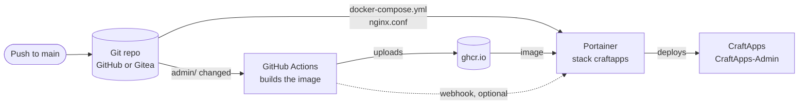
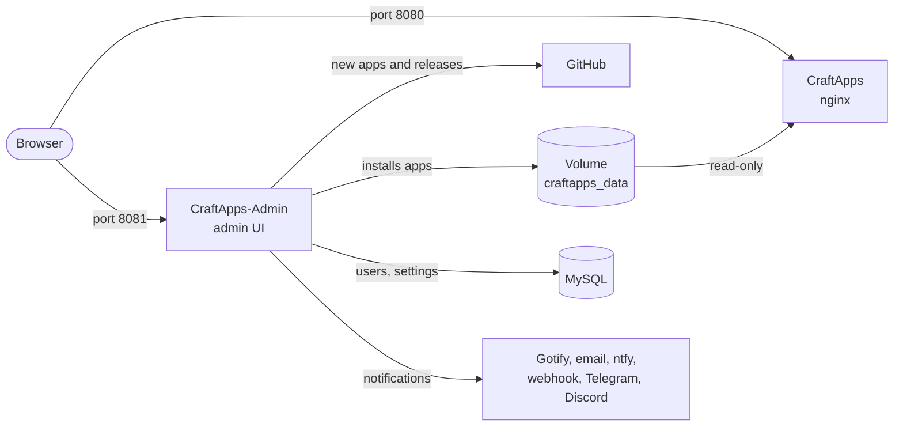
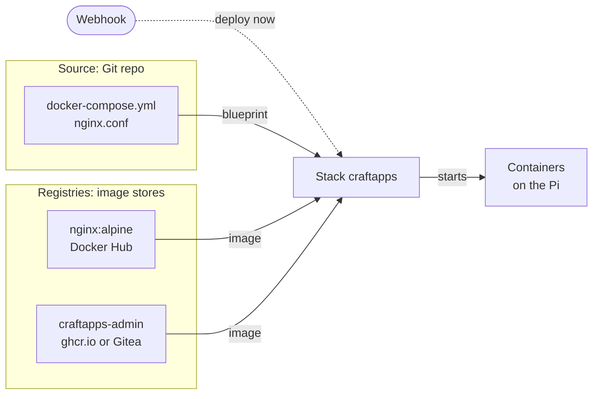
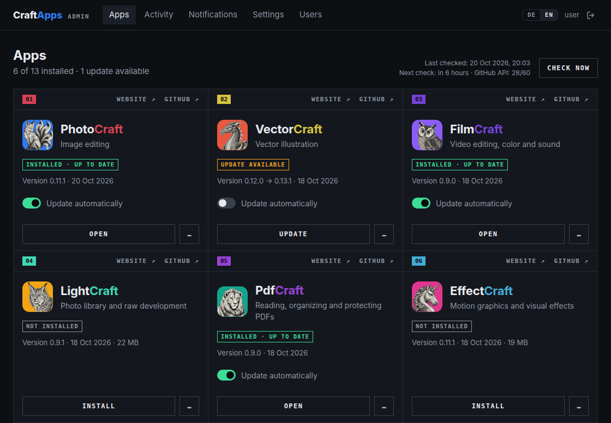
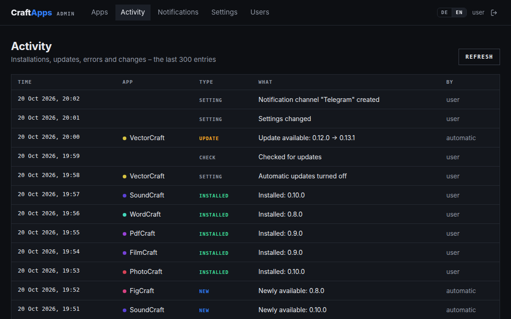
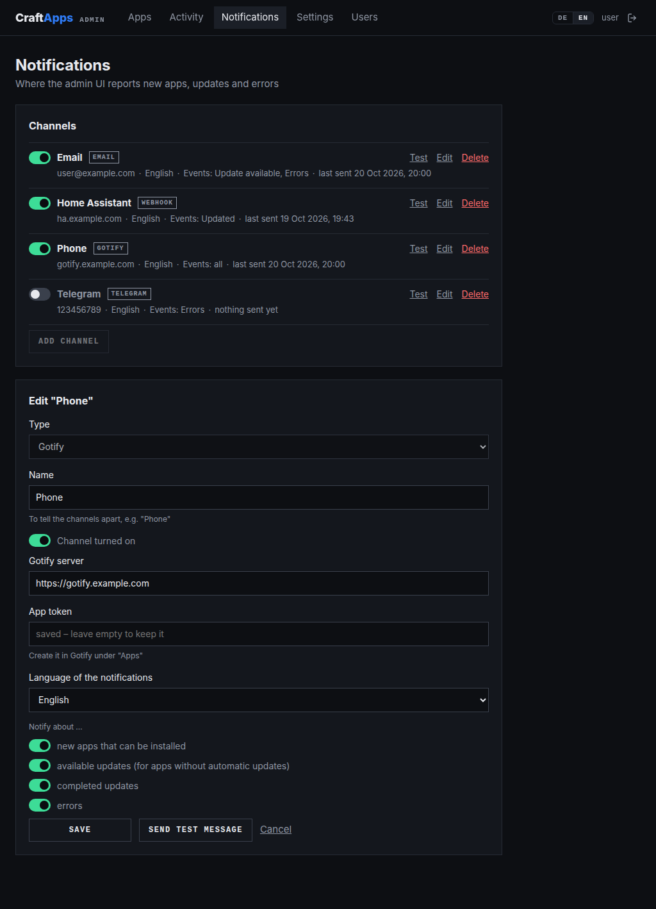
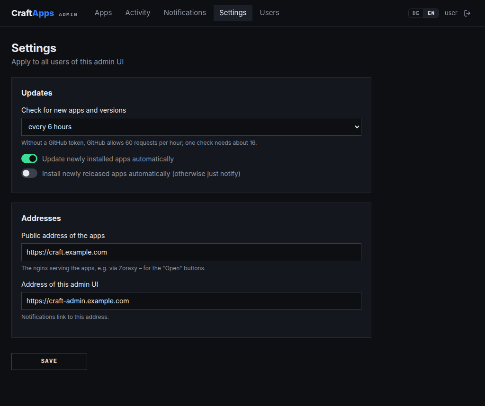
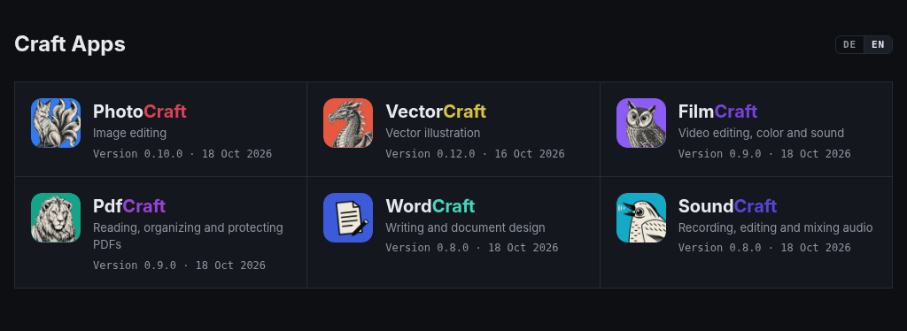
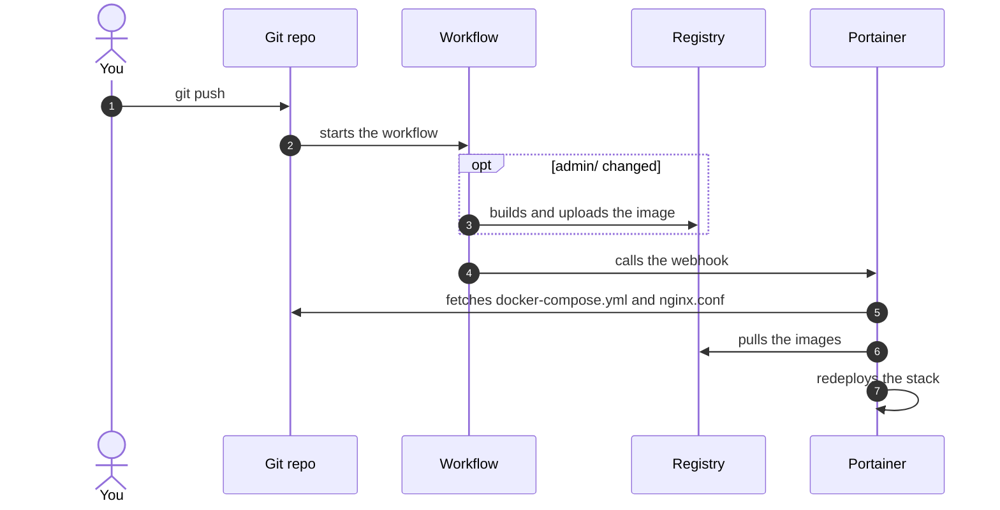

# CraftApps

**English** | [Deutsch](README.de.md)

Self-hosted web versions of the craft apps by [storytold](https://github.com/storytold)
(PhotoCraft, VectorCraft, FilmCraft, …) on a Raspberry Pi, with an admin UI in the style of
the Craft Launcher:

- **nginx** serves the installed apps (`/photocraft/`, `/vectorcraft/`, …) and shows an
  overview at `/`.
- **The admin UI** (Node.js/TypeScript) lists all available apps, installs and removes
  them, applies updates automatically or at the push of a button and reports everything
  via Gotify, email, ntfy, Telegram, Discord or a webhook. Its user interface is in English
  and German.

## Contents

- [Structure](#structure)
- [How everything fits together](#how-everything-fits-together)
- [What the admin UI can do](#what-the-admin-ui-can-do)
- [Setup](#setup)
- [Operation](#operation)
- [Notifications](#notifications)
- [Good to know](#good-to-know)
- [Development](#development)
- [Containers](#containers)
- [Troubleshooting](#troubleshooting)

## Structure

```text
CraftApps\
├── .gitea\workflows\admin-image.yaml   Also builds the image in Gitea (optional)
├── .github\workflows\admin-image.yaml  Builds the admin image (ARM64) to ghcr.io when admin\ changes
├── .vscode\                            Launch and debug in VS Code, recommended extensions
├── admin\                              Admin UI: Fastify server and React frontend
│   ├── Dockerfile
│   ├── public\                         Tab icons: admin UI, overview\ for the start page
│   └── src\
│       ├── server\                     Fastify server, main.ts starts it
│       │   ├── api\                    Routes for the admin UI
│       │   ├── apps\                   Find, install and update apps; start page
│       │   ├── auth\                   Users, sessions, login
│       │   ├── core\                   Configuration, database, helpers
│       │   ├── notify\                 Notification channels: Gotify, email, ntfy, webhook, Telegram, Discord
│       │   └── settings\               Settings
│       ├── shared\                     Types and messages (German/English) for server and frontend
│       └── web\                        React frontend, main.tsx starts it
│           ├── App\                    Top bar; on narrow screens with a burger and a user menu
│           ├── components\             AppCard, ChannelForm, LangSwitch, Toggle – each with its styles
│           ├── i18n\                   Language and texts, German and English in locales\
│           ├── lib\                    API calls and formatting
│           ├── pages\                  Apps, activity, notifications, settings, users, login – each with its styles
│           └── styles\                 Global SCSS; index.scss loads all styles
├── dev.sh                              Starts MySQL, admin UI and start page for a local test
├── docker-compose.dev.yml              MySQL for local development
├── docker-compose.yml                  Stack for Portainer: nginx and admin UI
├── docs\images\                        Screenshots for this README
└── nginx.conf                          nginx configuration
```

## How everything fits together

From a push to the running containers:



Portainer learns about changes in one of two ways:

|                                                | Polling and Watchtower (default)          | Webhook ([step 6](#6-deploy-after-the-build-optional)) |
| ---------------------------------------------- | ----------------------------------------- | ------------------------------------------------------ |
| Change in `docker-compose.yml` or `nginx.conf` | Portainer checks the repo every 5 minutes | The workflow calls Portainer right after the push      |
| New admin image                                | Watchtower pulls it on its next run       | Portainer pulls it right after the build               |
| Requires                                       | Watchtower                                | Portainer reachable from the workflow's runner         |

At runtime:



- By default, apps and admin UI are only reachable in the local network via the Pi's
  ports. A reverse proxy such as Zoraxy makes them public with your own domains and HTTPS,
  see [step 5](#5-https-via-reverse-proxy-optional).
- Portainer can't build images from a Git repo itself
  ([Portainer FAQ](https://docs.portainer.io/2.39-lts/faqs/troubleshooting/stacks-deployments-and-updates/can-i-build-an-image-while-deploying-a-stack-application-from-git)).
  That's why GitHub Actions builds the image and the compose file only references it.
- If the repo lives in Gitea, Gitea mirrors it to GitHub. Gitea Actions can additionally
  build the image into the Gitea registry, see
  [Building the image yourself](#building-the-image-yourself).
- `nginx.conf` is bind-mounted straight from the repo. That only works with
  "Enable relative path volumes" of Portainer Business Edition
  ([Portainer docs](https://docs.portainer.io/advanced/relative-paths)).
- nginx is the official image `nginx:alpine`. Watchtower or the deploy via webhook keeps it
  up to date.

### Portainer terms

Portainer gets two things from two places: the blueprint from the Git repo and the
finished images from registries. The stack combines both:



| Term                | What it is                                                                         | Where in Portainer                                             | Needed                                                |
| ------------------- | ---------------------------------------------------------------------------------- | -------------------------------------------------------------- | ----------------------------------------------------- |
| **Source**          | The Git repo with `docker-compose.yml` and `nginx.conf`, plus the token to read it | **Sources** in the left-hand menu                              | yes                                                   |
| **Stack**           | Runs the containers as described in `docker-compose.yml`                           | **Stacks → Add stack**                                         | yes                                                   |
| **Registry**        | Credentials for an image store that requires a login                               | **Registries**, depending on the version **Host → Registries** | only for an image that isn't public                   |
| **Webhook**         | Address of the stack that makes Portainer deploy                                   | in the stack under **GitOps updates**                          | only for [step 6](#6-deploy-after-the-build-optional) |
| **GitOps Workflow** | Rolls out stacks to Edge groups                                                    | **Workflows**                                                  | no, it's meant for Edge environments                  |

Public images such as `nginx:alpine` or the ready-made admin image need no registry entry.

## What the admin UI can do

- **Apps** in a grid like the Craft Launcher – with its icons, brand colors and short
  descriptions: install, update, reinstall, uninstall, toggle automatic updates per app.
- **New apps** it finds by itself: all storytold repos ending in `craft` whose latest
  release has a `<app>-web-*.zip`. New apps are reported and, if you like, installed
  automatically.
- **Updates without interruption:** new files go next to the old ones, `index.html` is
  switched last, the previous version stays until the next update. Every download is
  verified via SHA-256.
- **Login** with users in MySQL, activity log, settings (check interval, addresses) and
  user management.
- **Notifications** via Gotify, email, ntfy, Telegram, Discord or a webhook – as many
  channels as you like, each with its own events and language, see
  [Notifications](#notifications).
- **English and German:** the admin UI follows the browser's language and has a switch in
  the top bar, the start page at `/` likewise. Each notification channel uses the language
  set for it.

Data: users, settings, notification channels and history live in MySQL, the apps in the
volume `craftapps_data`, which nginx mounts read-only.

### Screenshots

**Apps:** one card per app – here installed, with an update waiting (automatic updates
turned off) and not installed yet:



**Activity:** what happened, automatically or by which user:



**Notifications:** the channels with their events, here with the form of a Gotify channel –
its saved token stays on the server:



**Settings:** check interval and addresses:



**Start page** at `/`: the installed apps, served by nginx:



## Setup

The steps build on each other. How each container is set up is collected under
[Containers](#containers); the steps link there where needed. The admin image is available
ready-made as `ghcr.io/pr0gh4nt3r/craftapps-admin:latest`, you don't have to build it
yourself.

Addresses, commands and templates contain placeholders for your values:

| Placeholder          | Meaning                                            | Example                                 |
| -------------------- | -------------------------------------------------- | --------------------------------------- |
| `<host>`             | Address of the Pi in the local network             | `192.168.1.10`                          |
| `<repo-url>`         | Address of the repo for cloning                    | `https://github.com/user/CraftApps.git` |
| `<apps-domain>`      | Domain for the apps                                | `craft.example.com`                     |
| `<admin-domain>`     | Domain for the admin UI                            | `craft-admin.example.com`               |
| `<portainer-domain>` | Public domain of Portainer                         | `portainer.example.com`                 |
| `<github-account>`   | Your GitHub account, in lowercase                  | `user`                                  |
| `<gitea-host>`       | Address of your Gitea instance, without `https://` | `gitea.example.com`                     |
| `<owner>`            | Gitea account that owns the repo                   | `user`                                  |

You only need the domains for [HTTPS via reverse proxy](#5-https-via-reverse-proxy-optional)
and [step 6](#6-deploy-after-the-build-optional), the last three only if you
[build the image yourself](#building-the-image-yourself).

### Overview

| Step                                     | What you do                                | Where                       | Required |
| ---------------------------------------- | ------------------------------------------ | --------------------------- | -------- |
| [1](#1-create-the-database)              | Create the database and its user           | MySQL                       | yes      |
| [2](#2-make-the-database-reachable)      | Decide how the admin UI reaches MySQL      | MySQL, `docker-compose.yml` | yes      |
| [3](#3-create-the-stack-in-portainer)    | Add the repo as a source, create the stack | Portainer                   | yes      |
| [4](#4-first-login)                      | Log in, enter addresses, add notifications | admin UI                    | yes      |
| [5](#5-https-via-reverse-proxy-optional) | Your own domains with HTTPS                | reverse proxy               | optional |
| [6](#6-deploy-after-the-build-optional)  | Deploy right after the build               | Portainer, repo             | optional |

### Prerequisites

- **Raspberry Pi** with a 64-bit OS and Docker. The admin image exists for ARM64 only.
- **Portainer Business Edition.** Only it can mount `nginx.conf` straight from the repo
  ("Enable relative path volumes"). This README follows the current interface with
  **Sources**; in older versions the repo fields are part of the stack form.
- **A Git repo with this project** that Portainer pulls the stack from: the public one on
  GitHub or your own, e.g. a fork or a repo in Gitea.
- **On the Pi** MySQL and Watchtower, optionally Zoraxy and Gotify. Watchtower isn't needed
  if Portainer deploys via webhook after the build (step 6). What CraftApps needs from
  them – and templates in case something is missing – is described under
  [Containers](#containers).

### Tokens and secrets at a glance

Which of them you need depends on your setup – with the public repo and the ready-made
image, none at all. Give each token only the permissions listed here.

| Token                  | What for                                                               | Permissions                                                  | Create it in                                                       | Enter it in                                                                          |
| ---------------------- | ---------------------------------------------------------------------- | ------------------------------------------------------------ | ------------------------------------------------------------------ | ------------------------------------------------------------------------------------ |
| Repo token, Gitea      | Portainer reads the repo, if it isn't public                           | **repository: Read**, **user: Read**                         | Gitea: **Settings → Applications**                                 | [source](#craftapps-and-craftapps-admin): **Access Token**                           |
| Repo token, GitHub     | the same for a private repo on GitHub                                  | fine-grained, **Contents: Read-only**                        | GitHub: **Settings → Developer settings → Personal access tokens** | [source](#craftapps-and-craftapps-admin): **Access Token**                           |
| Registry token, Gitea  | Portainer and Watchtower pull the image from Gitea, if it isn't public | **package: Read**                                            | Gitea: **Settings → Applications**                                 | [registry](#registry-in-portainer-optional): **Password**, [Watchtower](#watchtower) |
| Registry token, GitHub | Portainer pulls a private package from `ghcr.io`                       | classic, **read:packages**                                   | GitHub: **Settings → Developer settings → Personal access tokens** | [registry](#registry-in-portainer-optional): **Password**                            |
| `REGISTRY_TOKEN`       | the Gitea workflow uploads the image                                   | **package: Read and Write**                                  | Gitea: **Settings → Applications**                                 | Gitea repo: **Settings → Actions → Secrets**                                         |
| Mirror token           | Gitea mirrors the repo to GitHub                                       | fine-grained, **Contents** and **Workflows: Read and write** | GitHub: **Settings → Developer settings → Personal access tokens** | Gitea repo: **Settings → Mirror Settings**                                           |
| `PORTAINER_WEBHOOK`    | the workflow triggers the deploy                                       | –                                                            | Portainer: stack → **GitOps updates → Copy link**                  | repo secret, see [step 6](#6-deploy-after-the-build-optional)                        |
| Registration token     | the [Gitea runner](#gitea-runner) registers once                       | –                                                            | Gitea repo: **Settings → Actions → Runners**                       | stack `gitea-runner`, remove it afterwards                                           |
| `GITHUB_TOKEN`         | the admin UI checks for updates more often than about every 20 minutes | fine-grained, **Public repositories (read-only)**            | GitHub: **Settings → Developer settings → Personal access tokens** | `docker-compose.yml`, see [Good to know](#good-to-know)                              |

The repo token and the registry token for Gitea can also be one token with
**repository: Read**, **user: Read** and **package: Read**.

### 1. Create the database

In the `MySQL` container, e.g. in Portainer under **Containers → MySQL → Console** with
`mysql -uroot -p`:

```sql
CREATE DATABASE craftapps CHARACTER SET utf8mb4 COLLATE utf8mb4_unicode_ci;
CREATE USER 'craftapps'@'%' IDENTIFIED BY 'a-long-password';
GRANT ALL PRIVILEGES ON craftapps.* TO 'craftapps'@'%';
```

With phpMyAdmin instead: under **User accounts → Add user account**, enter the user name
`craftapps`, choose **Any host** (`%`) as host name and **Caching sha2 authentication** as
authentication plugin – the default of MySQL 8. Then tick
**Create database with same name and grant all privileges**. The other two plugins are
outdated: MySQL 8.4 disables **Native MySQL authentication** by default, and
**SHA256 password authentication** is deprecated.

You need the password in step 3 as `CRAFTAPPS_DB_PASSWORD`. The admin UI creates the tables
itself on its first start.

### 2. Make the database reachable

By default the stack gets its own Docker network. The admin UI therefore reaches MySQL via
the address in `CRAFTAPPS_DB_HOST`, in one of two ways:

| Way                      | `CRAFTAPPS_DB_HOST`                       | What it needs                                                                                                    |
| ------------------------ | ----------------------------------------- | ---------------------------------------------------------------------------------------------------------------- |
| **Via the Pi**           | `<host>`                                  | MySQL publishes port `3306` on the Pi, like the [MySQL template](#mysql)                                         |
| **Via a shared network** | name of the MySQL container, e.g. `MySQL` | both containers join the MySQL network via environment variables, see [Shared network](#shared-network-optional) |

### 3. Create the stack in Portainer

In Portainer you set up to three things, in this order:

1. **Source:** the repo with `docker-compose.yml`, see
   [CraftApps and CraftApps-Admin](#craftapps-and-craftapps-admin).
2. **Registry:** only for an image that isn't public, see
   [Registry in Portainer](#registry-in-portainer-optional). The ready-made image doesn't
   need it.
3. **Stack:** reads `docker-compose.yml` from the source and starts the containers, also
   under [CraftApps and CraftApps-Admin](#craftapps-and-craftapps-admin).

Afterwards the containers `CraftApps` and `CraftApps-Admin` are running, and the admin UI's
log says "Benutzer admin angelegt" (user admin created). If not, see
[Troubleshooting](#troubleshooting).

### 4. First login

Open `http://<host>:8081` and log in with `admin` and the password from
`CRAFTAPPS_ADMIN_PASSWORD`. Under **Settings**, enter:

| Setting                        | Without reverse proxy | With reverse proxy       | Used for                            |
| ------------------------------ | --------------------- | ------------------------ | ----------------------------------- |
| **Public address of the apps** | `http://<host>:8080`  | `https://<apps-domain>`  | the **Open** buttons                |
| **Address of this admin UI**   | `http://<host>:8081`  | `https://<admin-domain>` | opens when a notification is tapped |

Then add a channel under **Notifications**, e.g. Gotify (see [Gotify](#gotify)) or email,
and click **Send test message**.

About ten seconds after the start, the admin UI queries GitHub for the first time and then
shows all available apps. Finally, install an app and open it at `http://<host>:8080`.

### 5. HTTPS via reverse proxy (optional)

Browsers only allow WebGPU and the clipboard in a secure context, i.e. via HTTPS or
directly on `localhost`. Via `http://<host>:8080` the apps run, just without these
features. A reverse proxy in front adds HTTPS and your own domains, e.g. [Zoraxy](#zoraxy)
with certificates from Let's Encrypt:

| Domain           | Target        | Purpose  |
| ---------------- | ------------- | -------- |
| `<apps-domain>`  | `<host>:8080` | Apps     |
| `<admin-domain>` | `<host>:8081` | Admin UI |

Then switch both addresses in the admin UI's settings to `https://`.

### 6. Deploy after the build (optional)

Instead of polling and Watchtower, Portainer can deploy by itself as soon as the build has
finished. The pipeline is then push → build → deploy:



If the build fails, the workflow stops before the webhook and the running version stays.
This needs a build in your own repo, see
[Building the image yourself](#building-the-image-yourself): the ready-made image is built
in this project's repo, which doesn't know your Portainer.

1. **Set up the stack:** in Portainer, in the stack `craftapps` under **GitOps updates**:

   | Setting                | Value                                                                                           |
   | ---------------------- | ----------------------------------------------------------------------------------------------- |
   | **Mechanism**          | **Webhook**                                                                                     |
   | **Re-pull image**      | on – pulls the images again on every deploy                                                     |
   | **Force redeployment** | on – otherwise Portainer only deploys after changes in the repo, a new image alone isn't enough |
   | Webhook URL            | copy it with **Copy link**                                                                      |

   For an image from a registry that requires a login, **Re-pull image** needs the
   [registry in Portainer](#registry-in-portainer-optional).

2. **Check the URL:** **Copy link** uses the address you opened Portainer with, e.g.
   `https://<host>:9443/api/stacks/webhooks/<id>`. The runner has to reach it, and with
   HTTPS the certificate has to be valid, because the workflow checks it:

   | Runner                    | Suitable URL                                                                                                                      |
   | ------------------------- | --------------------------------------------------------------------------------------------------------------------------------- |
   | GitHub, from the internet | `https://<portainer-domain>/api/stacks/webhooks/<id>` via the reverse proxy; ideally expose only the path `/api/stacks/webhooks/` |
   | Gitea runner on the Pi    | also an address in the local network, as long as it has no self-signed certificate                                                |

3. **Add the secret:** add the URL as the secret `PORTAINER_WEBHOOK` in the repo whose build
   provides the stack's image – only there, otherwise Portainer deploys twice:

   | The stack uses …                   | Secret in       | Menu                                                                   |
   | ---------------------------------- | --------------- | ---------------------------------------------------------------------- |
   | your image from `ghcr.io`          | the GitHub repo | **Settings → Secrets and variables → Actions → New repository secret** |
   | your image from the Gitea registry | the Gitea repo  | **Settings → Actions → Secrets → Add secret**                          |

4. **Turn off Watchtower for CraftApps:** in the stack, set `CRAFTAPPS_WATCHTOWER` to
   `false`.

The workflow calls the URL as its last step: after a successful build and after changes to
`docker-compose.yml` or `nginx.conf`, which need no new image. Without the secret, the
workflow only builds. Anyone who knows the URL can redeploy the stack, so it belongs in the
secret only.

### Building the image yourself

Only needed if you don't want to use the ready-made image, or for
[step 6](#6-deploy-after-the-build-optional). In the stack, `CRAFTAPPS_ADMIN_IMAGE` then
points to your image.

|             | On GitHub                                                                           | In Gitea                                                               |
| ----------- | ----------------------------------------------------------------------------------- | ---------------------------------------------------------------------- |
| Workflow    | [.github/workflows/admin-image.yaml](.github/workflows/admin-image.yaml)            | [.gitea/workflows/admin-image.yaml](.gitea/workflows/admin-image.yaml) |
| Image       | `ghcr.io/<github-account>/craftapps-admin`                                          | `<gitea-host>/<owner>/craftapps-admin`                                 |
| Builds on   | GitHub's ARM64 runners                                                              | your own [runner](#gitea-runner), e.g. on the Pi                       |
| Secrets     | none                                                                                | `REGISTRY_TOKEN`                                                       |
| Builds when | `admin\` changes, on **Run workflow** and Mondays at 03:17 UTC for security updates | `admin\` changes and on **Run workflow**                               |

Both call `PORTAINER_WEBHOOK` afterwards if the secret exists, see
[step 6](#6-deploy-after-the-build-optional).

#### On GitHub

The workflow builds in every GitHub repo with this project, such as a fork.

1. In a fork, allow the workflows once under **Actions**.
2. Start the first build under **Actions → Verwaltung bauen → Run workflow**.
3. The package appears in your profile under **Packages** and inherits the repo's
   visibility. If it is private, set it to **Public** under
   **Package settings → Change visibility**. Otherwise Portainer and Watchtower need
   credentials, see [Registry in Portainer](#registry-in-portainer-optional).
4. In the stack, set `CRAFTAPPS_ADMIN_IMAGE` to
   `ghcr.io/<github-account>/craftapps-admin:latest`.

**Mirror from Gitea:** If the repo lives in Gitea, add a push mirror in the repo's
**Settings** under **Mirror Settings**: the address of the GitHub repo, your GitHub account
and the mirror token as password, **Sync when commits are pushed** on, then
**Add Push Mirror**. The mirror token needs **Contents** and **Workflows**, both with read
and write access. Without **Workflows**, GitHub rejects every push that changes
`.github/workflows/`.

#### In Gitea

1. **Enable Actions:** Actions and packages (the container registry) are enabled by
   default in current Gitea versions. Otherwise set `ENABLED = true` under `[actions]` and
   `[packages]` in `app.ini`, in a container via `GITEA__actions__ENABLED=true` and
   `GITEA__packages__ENABLED=true`, and restart Gitea. If the repo has no **Actions** tab,
   turn on **Enable Repository Actions** in the repo's **Settings**.
2. **Set up a runner** as described under [Gitea runner](#gitea-runner), until it shows up
   as online in Gitea.
3. **Token for the build:** in Gitea, with the account `<owner>`, create a token with
   **package: Read and Write** under **Settings → Applications**, e.g. `craftapps-build`,
   and add it in the repo under **Settings → Actions → Secrets** as the secret
   `REGISTRY_TOKEN`.
4. **Build the image:** under **Actions → Verwaltung bauen → Run workflow**. The first run
   downloads the runner's job image, about 0.5 GB. Afterwards the image is in your Gitea
   profile under **Packages**: `<gitea-host>/<owner>/craftapps-admin:latest`. The workflow
   writes the owner in lowercase because Docker doesn't allow uppercase letters in image
   names.
5. **Read access for Portainer and Watchtower,** if the packages aren't public – e.g.
   because your Gitea instance requires a login: create a token with **package: Read**,
   e.g. `pi-read`. Portainer gets it as a registry, see
   [Registry in Portainer](#registry-in-portainer-optional), Watchtower as `config.json`,
   see [Watchtower](#watchtower).
6. In the stack, set `CRAFTAPPS_ADMIN_IMAGE` to
   `<gitea-host>/<owner>/craftapps-admin:latest`.

## Operation

| You change …         | Polling and Watchtower                                                                                               | Webhook ([step 6](#6-deploy-after-the-build-optional))                       |
| -------------------- | -------------------------------------------------------------------------------------------------------------------- | ---------------------------------------------------------------------------- |
| Code in `admin\`     | GitHub Actions builds a new image, Watchtower deploys it on its next run.                                            | The workflow builds a new image, then Portainer deploys it.                  |
| `docker-compose.yml` | Portainer redeploys the stack within the polling interval.                                                           | Portainer redeploys the stack right after the push.                          |
| `nginx.conf`         | Portainer pulls the new file within the polling interval. Then restart `CraftApps` – nginx only reads it at startup. | Portainer pulls the new file right after the push. Then restart `CraftApps`. |
| nothing              | Mondays GitHub Actions rebuilds (security updates for Node and Alpine), Watchtower keeps nginx up to date.           | After the Monday build on GitHub, Portainer redeploys with fresh images.     |

- **To avoid waiting:** in Portainer **Containers → CraftApps-Admin → Recreate** with
  **Re-pull image**.
- **A manual build:** on GitHub under **Actions → Verwaltung bauen → Run workflow**.
- **Scheduled runs** are paused by GitHub if nothing happens in the repo for 60 days. They
  can be re-enabled under **Actions**.

## Notifications

Under **Notifications** you add as many channels as you like. Each one reports in its own
language, German or English, and only the events chosen for it. **Test** sends a test
message, the switch in the list turns a channel off without losing its settings.

| Channel  | What it needs                                                                                                     | Good to know                                                                  |
| -------- | ----------------------------------------------------------------------------------------------------------------- | ----------------------------------------------------------------------------- |
| Gotify   | server address and app token, see [Gotify](#gotify)                                                               | push notifications to the phone                                               |
| Email    | SMTP server, port, encryption (STARTTLS, TLS or none), sender and recipients; username and password for a login   | several recipients separated by commas                                        |
| ntfy     | server, e.g. `https://ntfy.sh`, and topic; an access token for protected topics                                   | on ntfy.sh anyone who knows the topic can read along – pick one hard to guess |
| Webhook  | URL, optionally an `Authorization` header                                                                         | JSON via `POST`, see below – e.g. for Home Assistant, n8n or Node-RED         |
| Telegram | bot token from [@BotFather](https://t.me/BotFather) and chat ID: your own, a group's (with a minus) or `@channel` | send `/start` to the bot first – bots can't start a conversation              |
| Discord  | webhook URL, in Discord under **Edit Channel → Integrations → Webhooks**                                          |                                                                               |

The events and their priority:

| Event                                                                          | Gotify | ntfy        |
| ------------------------------------------------------------------------------ | ------ | ----------- |
| New app available (on the very first start and as a summary from four at once) | 5      | 3 (default) |
| Update available – only for apps with automatic updates turned off             | 5      | 3 (default) |
| Update applied (automatically or by button), new app installed automatically   | 4      | 3 (default) |
| Error – each error once, not again on every check                              | 8      | 4 (high)    |

Emails about errors are marked as important, Discord shows them in red. Tapping a
notification opens the admin UI – emails, Telegram and Discord link to it.

- **Secrets** – tokens, passwords and the URLs of webhooks and Discord – are stored in
  MySQL and never go back to the browser: the form only shows that they are saved. Left
  empty when saving, they stay as they are; optional ones can be removed.
- **The list** shows when each channel last sent something, or why the last attempt failed.
  The activity log notes every failed notification as well.
- **Updating from a version without channels:** the Gotify settings become the channel
  "Gotify" on the first start, with the same events and language.

**Webhook:** each notification arrives as JSON via `POST`:

```json
{
  "event": "updated",
  "title": "PhotoCraft updated",
  "message": "**0.9.0 → 0.10.0** (automatically)",
  "priority": 4,
  "url": "https://craft-admin.example.com"
}
```

`event` is `newApps`, `updateAvailable`, `updated`, `errors` or `test`, `message` is
Markdown, `priority` follows the Gotify scale from 0 to 10, and `url` is the address of the
admin UI or `null`.

## Good to know

- Each check needs about 16 requests to the GitHub API. Without a token GitHub allows 60
  per hour; for check intervals below about 20 minutes set `GITHUB_TOKEN` in
  `docker-compose.yml`.
- Login: at most 10 attempts per 15 minutes and IP address.
- The admin UI takes order, names, colors, English and German texts and icons from the
  [Craft Launcher](https://github.com/storytold/craft-launcher). If it is unreachable, the
  last known state applies.
- The admin container runs as user 1000 with a read-only file system and without Linux
  capabilities. A new volume `craftapps_data` belongs to this user automatically. If the
  admin UI still reports missing write access, run
  `sudo chown -R 1000:1000 /var/lib/docker/volumes/craftapps_data/_data` on the Pi.

## Development

Meant for Linux or WSL with Node.js 24 and Docker. On WSL the repo belongs in the Linux file
system (not under `/mnt/c`), otherwise Vite doesn't reliably notice changes. Docker runs
there either directly in the distribution or via Docker Desktop with WSL integration
enabled for the distribution, but not both.

One command in the main folder starts everything for a local test, **Ctrl+C** stops it all
again:

```bash
./dev.sh
```

- **Admin UI** at `http://localhost:5173`: Vite shows changes to the frontend right away,
  the server restarts on changes.
- **Start page** at `http://localhost:8080`: nginx with `nginx.conf` as on the Pi, serving
  `admin/data`. Another port: `START_PAGE_PORT=8090 ./dev.sh`.
- Beforehand the script starts MySQL from `docker-compose.dev.yml` – and at the end stops it
  only if it started it. It runs `npm ci` if the dependencies are missing or
  `package-lock.json` changed, and creates `admin/.env` from `.env.example` if it's missing.

Log in with `admin` and the password from `admin/.env`. Installed apps end up in
`admin/data`. So that the **Open** buttons lead to the local start page, enter
`http://localhost:8080` as **Public address of the apps** under **Settings**.

The same step by step:

```bash
docker compose -f docker-compose.dev.yml up -d   # MySQL for development
cd admin
npm ci
cp .env.example .env                       # once; matches docker-compose.dev.yml
npm run dev:server                         # server, restarts on changes
npm run dev:web                            # second terminal: UI at http://localhost:5173
# third terminal, in the main folder: start page at http://localhost:8080
docker run --rm -p 127.0.0.1:8080:80 \
  -v "$PWD/nginx.conf:/etc/nginx/conf.d/default.conf:ro" \
  -v "$PWD/admin/data:/srv/craftapps:ro" nginx:alpine
```

**Debugging in VS Code:** open the `CraftApps` folder itself, not a folder above it –
VS Code only reads the launch configurations from the opened folder's `.vscode`. Then start
"Server und Oberfläche" (server and frontend) under **Run and Debug** instead of
`./dev.sh`. That starts both, but not MySQL and the start page – see the steps above.
Breakpoints work directly in the server's TypeScript. Debug the frontend with the browser's
developer tools.

**Checks** – must pass without errors before every commit:

```bash
npm run lint    # ESLint, warnings count as errors
npm run build   # tsc for UI and server, Vite build as in CI
```

## Containers

All containers run on the Pi and are created in Portainer as stacks. `CraftApps` and
`CraftApps-Admin` are CraftApps itself; you only need the `gitea-runner` to build the image
in Gitea. For the others you'll find what CraftApps needs from them and a template in case
one is missing.

| Container         | Image                                       | Task                                            |
| ----------------- | ------------------------------------------- | ----------------------------------------------- |
| `CraftApps`       | `nginx:alpine`                              | serves the apps                                 |
| `CraftApps-Admin` | `ghcr.io/pr0gh4nt3r/craftapps-admin:latest` | the admin UI                                    |
| `gitea-runner`    | `gitea/act_runner:latest`                   | builds the image in Gitea, optional             |
| `MySQL`           | e.g. `mysql:8.4`                            | users, settings and history                     |
| Watchtower        | e.g. `nickfedor/watchtower:latest`          | deploys new images, not needed with the webhook |
| Zoraxy            | e.g. `zoraxydocker/zoraxy:latest`           | domains and HTTPS, optional                     |
| Gotify            | e.g. `gotify/server:latest`                 | push notifications, optional                    |

### CraftApps and CraftApps-Admin

Both are defined in [docker-compose.yml](docker-compose.yml) and run as the stack
`craftapps`. In Portainer, first add the repo as a source, then create the stack from it.

**1. Add the repo as a source:** in Portainer, select **Sources** in the left-hand menu,
then **Add new**:


| Field                       | Value                                                     |
| --------------------------- | --------------------------------------------------------- |
| **Source Name**             | any name, e.g. `Gitea`                                    |
| **Repository URL**          | `<repo-url>`, the address for cloning – not `localhost`   |
| **Skip TLS Verification**   | off                                                       |
| **Authentication**          | on if the repo isn't public, then the next four fields    |
| **Use a shared credential** | off – or on to use credentials already saved in Portainer |
| **Git Provider**            | your Git server, e.g. **Gitea / Forgejo**                 |
| **Username**                | your account there                                        |
| **Access Token**            | the [repo token](#tokens-and-secrets-at-a-glance)         |
| **Enable polling**          | off – the stack decides when to deploy                    |

Once the connection test succeeds, continue to **Access control**, choose who may use the
source – **Administrators** is enough – and click **Create**. The source then shows up as
**Healthy**, i.e. Portainer can read the repo:


`0` under **Workflows** and **Environments** is fine, CraftApps doesn't use GitOps
workflows.

**2. Create the stack:** open the Pi's environment, then **Stacks → Add stack**:

| Field                            | Value                                                                                                                                                                                                                                                               |
| -------------------------------- | ------------------------------------------------------------------------------------------------------------------------------------------------------------------------------------------------------------------------------------------------------------------- |
| **Name**                         | `craftapps`                                                                                                                                                                                                                                                         |
| Build method                     | **Git Repository**                                                                                                                                                                                                                                                  |
| **Source**                       | the source from step 1                                                                                                                                                                                                                                              |
| **Repository reference**         | `refs/heads/main`                                                                                                                                                                                                                                                   |
| **Compose path**                 | `docker-compose.yml`, Portainer's default                                                                                                                                                                                                                           |
| **Additional paths**             | none                                                                                                                                                                                                                                                                |
| **GitOps updates**               | on, see the next table                                                                                                                                                                                                                                              |
| **Enable relative path volumes** | on                                                                                                                                                                                                                                                                  |
| **Local filesystem path**        | a neutral folder such as `/opt/stacks` – it must exist on the Pi and be writable. Portainer clones the whole repo below it, into `portainer-compose-unpacker/stacks/craftapps/`, and nginx gets `nginx.conf` from that clone. Other stacks can use the same folder. |
| **Environment variables**        | see below                                                                                                                                                                                                                                                           |

In older versions, the build method is called **Repository**, and instead of a source the
form asks for **Repository URL** and **Authentication** – with the same values as the
source.

**GitOps updates**, depending on how Portainer should deploy:

| Setting                                     | Polling (default)                                                                            | Webhook ([step 6](#6-deploy-after-the-build-optional)) |
| ------------------------------------------- | -------------------------------------------------------------------------------------------- | ------------------------------------------------------ |
| **Mechanism**                               | **Polling**                                                                                  | **Webhook**                                            |
| **Fetch interval**                          | `5m`                                                                                         | –                                                      |
| **Re-pull image**                           | on                                                                                           | on                                                     |
| **Force redeployment**                      | off – otherwise Portainer redeploys every 5 minutes                                          | on – otherwise a new image alone doesn't deploy        |
| **Prune services**, if offered              | on – removes containers of services that are no longer in `docker-compose.yml`, volumes stay | on                                                     |
| Environment variable `CRAFTAPPS_WATCHTOWER` | not set, i.e. `true`                                                                         | `false`                                                |

**Environment variables:**

| Variable                     | Value                                                                                                   |
| ---------------------------- | ------------------------------------------------------------------------------------------------------- |
| `CRAFTAPPS_DB_HOST`          | Address of the database, see [step 2](#2-make-the-database-reachable)                                   |
| `CRAFTAPPS_DB_PASSWORD`      | Password from [step 1](#1-create-the-database)                                                          |
| `CRAFTAPPS_ADMIN_PASSWORD`   | Password for the first account `admin`, at least 10 characters                                          |
| `CRAFTAPPS_WEB_PORT`         | only for a different apps port than `8080`                                                              |
| `CRAFTAPPS_ADMIN_PORT`       | only for a different admin UI port than `8081`                                                          |
| `CRAFTAPPS_DB_PORT`          | only if MySQL doesn't listen on port `3306`                                                             |
| `CRAFTAPPS_ADMIN_IMAGE`      | only for your [own image](#building-the-image-yourself)                                                 |
| `CRAFTAPPS_WATCHTOWER`       | `false` if Portainer deploys via webhook ([step 6](#6-deploy-after-the-build-optional))                 |
| `CRAFTAPPS_NETWORK`          | only for an existing network instead of the stack's own, see [Shared network](#shared-network-optional) |
| `CRAFTAPPS_NETWORK_EXTERNAL` | `true` together with `CRAFTAPPS_NETWORK`                                                                |
| `CRAFTAPPS_WEB_IP`           | only for a fixed IP of `CraftApps` in that network                                                      |
| `CRAFTAPPS_ADMIN_IP`         | only for a fixed IP of `CraftApps-Admin` in that network                                                |

Then **Deploy the stack**.

**What docker-compose.yml contains:**

|                         | `CraftApps`                            | `CraftApps-Admin`                                                      |
| ----------------------- | -------------------------------------- | ---------------------------------------------------------------------- |
| Image                   | `nginx:alpine`                         | `ghcr.io/pr0gh4nt3r/craftapps-admin:latest` or `CRAFTAPPS_ADMIN_IMAGE` |
| Port on the Pi          | `8080`                                 | `8081`                                                                 |
| Network                 | the stack's own or `CRAFTAPPS_NETWORK` | the stack's own or `CRAFTAPPS_NETWORK`                                 |
| Volume `craftapps_data` | at `/srv/craftapps`, read-only         | at `/data`                                                             |
| Updates                 | Watchtower or Portainer via webhook    | Watchtower or Portainer via webhook, after every build                 |

- nginx reads `nginx.conf` only at startup: restart the `CraftApps` container after a
  change.
- The admin UI connects to MySQL via `CRAFTAPPS_DB_HOST` and only creates the account
  `admin` while there is no user yet.
- It runs as user 1000 with a read-only file system, without Linux capabilities and with
  `no-new-privileges`. Docker checks via `/healthz` whether it is running.
- Optionally `GITHUB_TOKEN` for check intervals below about 20 minutes, see
  [Good to know](#good-to-know).

### Registry in Portainer (optional)

Portainer only needs a registry for an image that isn't public. The ready-made image
`ghcr.io/pr0gh4nt3r/craftapps-admin` is public, so you can skip this.

| Image                                        | Registry in Portainer                                                      |
| -------------------------------------------- | -------------------------------------------------------------------------- |
| `ghcr.io/pr0gh4nt3r/craftapps-admin`         | not needed                                                                 |
| your own image on `ghcr.io`, public package  | not needed                                                                 |
| your own image on `ghcr.io`, private package | GitHub                                                                     |
| image from the Gitea registry                | Gitea, if the packages aren't public – e.g. because Gitea requires a login |

How to add it:

1. In Portainer under **Registries** – depending on the version **Host → Registries** –
   click **Add registry** and choose **Custom registry**.
2. Fill in the fields:

   | Field              | Gitea                        | GitHub                                 |
   | ------------------ | ---------------------------- | -------------------------------------- |
   | **Name**           | `Gitea`                      | `GitHub`                               |
   | **Registry URL**   | `<gitea-host>`               | `ghcr.io`                              |
   | **Authentication** | on                           | on                                     |
   | **Username**       | `<owner>`                    | `<github-account>`                     |
   | **Password**       | token with **package: Read** | token (classic) with **read:packages** |

3. Save with **Add registry**.

Create the Gitea token there under **Settings → Applications**, the GitHub one under
**Settings → Developer settings → Personal access tokens → Tokens (classic)**. `ghcr.io`
doesn't accept fine-grained tokens. You don't need the provider **GitHub** that Portainer BE
also offers: it asks for a token with far more permissions (`repo`, `write:packages`,
`delete:packages`), while a **Custom registry** with `read:packages` is enough for pulling.

**Registry URL, image name and package page** are easily mixed up:

|                                                                                           | Gitea                                                                      | GitHub                                                                                 |
| ----------------------------------------------------------------------------------------- | -------------------------------------------------------------------------- | -------------------------------------------------------------------------------------- |
| **Registry URL** in Portainer: host only, without `https://` and path                     | `<gitea-host>`                                                             | `ghcr.io`                                                                              |
| **Image name** in the stack (`CRAFTAPPS_ADMIN_IMAGE`): owner lowercase, tag after a colon | `<gitea-host>/<owner>/craftapps-admin:latest`                              | `ghcr.io/<github-account>/craftapps-admin:latest`                                      |
| **Package page** in the browser: not usable in Portainer                                  | `https://<gitea-host>/<owner>/-/packages/container/craftapps-admin/latest` | `https://github.com/users/<github-account>/packages/container/package/craftapps-admin` |

The package page shows the matching `docker pull` command; the image name is what follows
`docker pull`.

Portainer uses the credentials automatically for images whose name starts with the registry
URL: when deploying the stack and with **Re-pull image**
([step 6](#6-deploy-after-the-build-optional)). Nothing changes in `docker-compose.yml`.
Watchtower needs the credentials separately, see [Watchtower](#watchtower).

- **Not `localhost`:** Portainer runs in its own container, so `localhost` would be
  Portainer itself. Besides, Gitea's registry always sends Docker to its public address
  to log in.
- **You don't need Browse:** it only lists the images in the registry. Docker pulls them
  itself, always via HTTPS. If **Browse** fails with `dial tcp <IP>:80: i/o timeout`, see
  [Troubleshooting](#in-portainer).

### Gitea runner

Only for the [image in Gitea](#in-gitea): the runner builds it whenever `admin\` changes.
On the Pi it builds natively for ARM64; on another machine the workflow emulates ARM64 via
QEMU, which takes considerably longer.

1. **Get a registration token:** in Gitea, in the repo under **Settings → Actions →
   Runners → Create new Runner**. A runner at repo level only runs this repo's workflows.
2. **Create the stack:** in Portainer under **Stacks → Add stack** a stack `gitea-runner`
   with the **Web editor**:

   ```yaml
   services:
     runner:
       image: gitea/act_runner:latest
       container_name: gitea-runner
       restart: unless-stopped
       environment:
         GITEA_INSTANCE_URL: https://<gitea-host>
         GITEA_RUNNER_REGISTRATION_TOKEN: "<registration-token>"
         GITEA_RUNNER_NAME: pi
         GITEA_RUNNER_LABELS: ubuntu-latest:docker://gitea/runner-images:ubuntu-latest
       volumes:
         - runner-data:/data
         - /var/run/docker.sock:/var/run/docker.sock

   volumes:
     runner-data:
   ```

   The workflow requires the label `ubuntu-latest`. Its jobs therefore run in the image
   `gitea/runner-images:ubuntu-latest`, which exists for ARM64 and includes the Docker CLI
   and Buildx. The build uses the Pi's Docker via the mounted socket.

3. **Check:** under **Settings → Actions → Runners** the runner `pi` shows up as online.
4. **Remove the registration token again:** the runner has now stored its own credentials
   in the volume `runner-data` and only registers again if they are missing. Delete the
   line `GITEA_RUNNER_REGISTRATION_TOKEN` in the stack and **Update the stack**.
   `GITEA_RUNNER_LABELS` stays, the runner applies the labels on every start. Optionally
   reset the registration token in Gitea – the runner logs in with its own credentials and
   keeps running.

> The runner can control Docker on the Pi. Only let it run workflows from repos you trust.
>
> Don't delete the volume `runner-data` along with the stack. Otherwise the runner has to
> register again with a new registration token; then delete the old entry under
> **Settings → Actions → Runners**.

### Shared network (optional)

Without further settings the stack gets its own Docker network. If the admin UI should
reach MySQL via its container name, or the reverse proxy should reach the containers
directly, both containers can join an existing network instead – with these environment
variables in the stack, without changing `docker-compose.yml`:

| Variable                     | Value                                                                     | Example       |
| ---------------------------- | ------------------------------------------------------------------------- | ------------- |
| `CRAFTAPPS_NETWORK`          | name of the existing network, see **Networks** in Portainer               | `shared`      |
| `CRAFTAPPS_NETWORK_EXTERNAL` | `true`, so that Compose uses the existing network instead of creating one | `true`        |
| `CRAFTAPPS_WEB_IP`           | optional: fixed IP of `CraftApps`                                         | `172.20.0.10` |
| `CRAFTAPPS_ADMIN_IP`         | optional: fixed IP of `CraftApps-Admin`                                   | `172.20.0.11` |
| `CRAFTAPPS_DB_HOST`          | name of the MySQL container in this network                               | `MySQL`       |

- Both containers are then only in this network, the stack doesn't create its own.
- Fixed IPs only work in a network with its own subnet, e.g. one created with
  `docker network create --subnet 172.20.0.0/16 shared`, and only with free addresses.
- Zoraxy can then use `CraftApps:80` and `CraftApps-Admin:3000` as targets if it's in the
  same network, or the fixed IPs – instead of the Pi's ports.

### MySQL

**What CraftApps needs:** MySQL 8 with the database and user from
[step 1](#1-create-the-database), reachable for `CraftApps-Admin` at `CRAFTAPPS_DB_HOST`,
see [step 2](#2-make-the-database-reachable).

**If it's missing:** stack `mysql` with the **Web editor**, the root password under
**Environment variables** as `MYSQL_ROOT_PASSWORD`. Port `3306` is then reachable in the
whole local network, `CRAFTAPPS_DB_HOST` is `<host>`:

```yaml
services:
  mysql:
    image: mysql:8.4
    container_name: MySQL
    restart: unless-stopped
    environment:
      MYSQL_ROOT_PASSWORD: ${MYSQL_ROOT_PASSWORD}
      TZ: Europe/Berlin
    ports:
      - 3306:3306
    volumes:
      - mysql-data:/var/lib/mysql

volumes:
  mysql-data:
```

### Watchtower

If Portainer deploys via webhook ([step 6](#6-deploy-after-the-build-optional)), CraftApps
doesn't need Watchtower; then set `CRAFTAPPS_WATCHTOWER=false` in the stack.

**What CraftApps needs:**

- **Access to the registry,** only for an image from a registry that requires a login,
  such as the Gitea registry. The credentials for `<gitea-host>` then belong in a separate
  `config.json`. Log in on the Pi, with the read token from [In Gitea](#in-gitea) as
  password:

  ```bash
  sudo docker --config /opt/watchtower login <gitea-host> -u <owner>
  ```

  Then mount the file `/opt/watchtower/config.json` into Watchtower as `/config.json`, as
  in the template below. `REPO_USER` and `REPO_PASS` aren't suitable for this: Watchtower
  sends them to every registry, Docker Hub included.

- **Updates despite monitor-only.** `CraftApps` and `CraftApps-Admin` carry the label
  `com.centurylinklabs.watchtower.monitor-only=false`. If your Watchtower runs with
  `WATCHTOWER_MONITOR_ONLY=true`, the label only takes effect together with
  `WATCHTOWER_LABEL_TAKE_PRECEDENCE=true`. Otherwise Watchtower only reports the updates.
- **Docker 29.** The old image `containrrr/watchtower` has been unmaintained since December
  2025 and needs `DOCKER_API_VERSION=1.44` from Docker 29 on. The fork
  `nickfedor/watchtower` understands the same labels and variables and negotiates the API
  version itself.

**If it's missing:** stack `watchtower` with the **Web editor**. The `config.json` line is
only needed for a registry with login; create the file first as described above:

```yaml
services:
  watchtower:
    image: nickfedor/watchtower:latest
    container_name: Watchtower
    restart: unless-stopped
    environment:
      TZ: Europe/Berlin
      WATCHTOWER_CLEANUP: "true" # remove old images after an update
      WATCHTOWER_SCHEDULE: "0 0 4 * * *" # daily at 4 am
    volumes:
      - /var/run/docker.sock:/var/run/docker.sock
      - /opt/watchtower/config.json:/config.json:ro
```

### Zoraxy

**What CraftApps needs:** nothing, Zoraxy is optional and adds HTTPS and your own domains,
see [step 5](#5-https-via-reverse-proxy-optional). The targets are the Pi's ports,
`<host>:8080` and `<host>:8081`; in a [shared network](#shared-network-optional) also the
containers directly.

**If it's missing:** stack `zoraxy` with the **Web editor**. The router has to forward ports
80 and 443 to the Pi.

```yaml
services:
  zoraxy:
    image: zoraxydocker/zoraxy:latest
    container_name: Zoraxy
    restart: unless-stopped
    ports:
      - 80:80
      - 443:443
      - 8000:8000 # Zoraxy's own web UI
    environment:
      TZ: Europe/Berlin
    volumes:
      - zoraxy-config:/opt/zoraxy/config/
      - zoraxy-plugin:/opt/zoraxy/plugin/
    extra_hosts:
      - host.docker.internal:host-gateway

volumes:
  zoraxy-config:
  zoraxy-plugin:
```

Then open the web UI at `http://<host>:8000`, create an account and get the certificates via
ACME (Let's Encrypt).

### Gotify

**What CraftApps needs:** an app token. In Gotify under **Apps → Create Application**,
create an application `CraftApps` and enter the token together with the server's address as
a channel under **Notifications**, see [Notifications](#notifications).

**If it's missing:** stack `gotify` with the **Web editor**, the password for the account
`admin` under **Environment variables** as `GOTIFY_ADMIN_PASSWORD`:

```yaml
services:
  gotify:
    image: gotify/server:latest
    container_name: Gotify
    restart: unless-stopped
    environment:
      TZ: Europe/Berlin
      GOTIFY_DEFAULTUSER_PASS: ${GOTIFY_ADMIN_PASSWORD}
    ports:
      - 8070:80
    volumes:
      - gotify-data:/app/data

volumes:
  gotify-data:
```

The address for the admin UI is then `http://<host>:8070`. For the phone app to reach Gotify
on the go as well, add a proxy rule in Zoraxy for a domain of your own with the target
`<host>:8070`.

## Troubleshooting

Sorted by where the problem shows up. The admin UI shows its messages in its language, the
log in German.

### In Portainer

| Symptom                                                                                       | Cause                                                                                                        | Fix                                                                                                                 |
| --------------------------------------------------------------------------------------------- | ------------------------------------------------------------------------------------------------------------ | ------------------------------------------------------------------------------------------------------------------- |
| **Create Source:** `Connection failed` with `authorization failed: Forbidden`                 | Gitea accepts the token, but it lacks a permission – e.g. the registry token with only **package: Read**     | token with **repository: Read** and **user: Read**, see [Tokens and secrets](#tokens-and-secrets-at-a-glance)       |
| `localhost` as **Repository URL** or **Registry URL** doesn't work                            | in Portainer's container, `localhost` is Portainer itself                                                    | the public address, e.g. `https://<gitea-host>/<owner>/CraftApps.git` or `<gitea-host>`                             |
| **Registries → Browse:** `dial tcp <IP>:80: i/o timeout`                                      | Portainer tries port 80, but the router only forwards port 443                                               | not needed for deploying, Docker pulls via HTTPS. For Browse, forward port 80 to the reverse proxy                  |
| Deploy: `required variable CRAFTAPPS_DB_HOST is missing a value`                              | a required environment variable is missing                                                                   | add it under **Environment variables** in the stack, see [the table](#craftapps-and-craftapps-admin)                |
| Deploy: `unauthorized` or `pull access denied` for the admin image                            | the image isn't public and Portainer has no credentials for it, or the image name is wrong                   | [Registry in Portainer](#registry-in-portainer-optional); image name with the registry URL as host, owner lowercase |
| Deploy: `Bind for 0.0.0.0:8081 failed: port is already allocated`                             | another container on the Pi already uses the port; `docker ps --format '{{.Names}}: {{.Ports}}'` shows which | set `CRAFTAPPS_WEB_PORT` or `CRAFTAPPS_ADMIN_PORT` to a free port                                                   |
| `CraftApps` doesn't start: `Are you trying to mount a directory onto a file (or vice-versa)?` | **Enable relative path volumes** is off, so Docker can't find `./nginx.conf`                                 | create the stack with **Enable relative path volumes** and a **Local filesystem path**                              |
| Deploy: `network … declared as external, but could not be found`                              | `CRAFTAPPS_NETWORK` is missing or misspelled, or the network doesn't exist                                   | check the name under **Networks**, see [Shared network](#shared-network-optional)                                   |
| Deploy: `no configured subnet contains IP address …`                                          | the fixed IP isn't in the network's subnet, or `CRAFTAPPS_NETWORK` is missing                                | an IP from the network's subnet, see [Shared network](#shared-network-optional)                                     |
| Deploy: `Address already in use`                                                              | another container already has the fixed IP                                                                   | a free IP                                                                                                           |

### Build and deploy

| Symptom                                                                                                   | Cause                                                                                      | Fix                                                                                           |
| --------------------------------------------------------------------------------------------------------- | ------------------------------------------------------------------------------------------ | --------------------------------------------------------------------------------------------- |
| Gitea: the job stays at **Waiting**, `No runner is online to pick up this job.`                           | no runner online, or none with the label `ubuntu-latest`                                   | [Gitea runner](#gitea-runner)                                                                 |
| Gitea workflow: **Bei der Gitea-Registry anmelden** or **Bauen und hochladen** fails                      | `REGISTRY_TOKEN` is missing or lacks **package: Read and Write**                           | [In Gitea](#in-gitea), step 3                                                                 |
| The push mirror to GitHub fails: `refusing to allow a Personal Access Token to create or update workflow` | the mirror token lacks **Workflows**                                                       | mirror token with **Contents** and **Workflows: Read and write**, see [On GitHub](#on-github) |
| Step **In Portainer deployen** fails with `curl: (6)`, `(7)` or `(28)`                                    | the runner can't reach the webhook URL                                                     | a public address via the reverse proxy, see [step 6](#6-deploy-after-the-build-optional)      |
| Step **In Portainer deployen** fails with `curl: (60) SSL certificate problem`                            | self-signed certificate, e.g. Portainer's own on port 9443                                 | an address with a valid certificate, e.g. via the reverse proxy                               |
| Step **In Portainer deployen** fails with `curl: (22) The requested URL returned error`                   | the URL is wrong or outdated – a newly created stack gets a new one                        | copy the URL again and update the secret `PORTAINER_WEBHOOK`                                  |
| A new image doesn't arrive                                                                                | Webhook: **Force redeployment** is off. Polling: Watchtower hasn't run yet or only reports | [step 6](#6-deploy-after-the-build-optional) or [Watchtower](#watchtower)                     |

### Admin UI

| Symptom                                                                                                                                                  | Cause                                                                                           | Fix                                                                                                                                                                                |
| -------------------------------------------------------------------------------------------------------------------------------------------------------- | ----------------------------------------------------------------------------------------------- | ---------------------------------------------------------------------------------------------------------------------------------------------------------------------------------- |
| Log: `MySQL noch nicht erreichbar (connect ECONNREFUSED …)`, `(getaddrinfo ENOTFOUND …)` or `(connect ETIMEDOUT)`; after a minute the container restarts | `CRAFTAPPS_DB_HOST` is wrong, or MySQL isn't reachable from the container                       | [step 2](#2-make-the-database-reachable)                                                                                                                                           |
| Log: `MySQL noch nicht erreichbar (Access denied for user 'craftapps'@…)`                                                                                | wrong password, or the user doesn't exist                                                       | [step 1](#1-create-the-database), `CRAFTAPPS_DB_PASSWORD`                                                                                                                          |
| Login with the password from `CRAFTAPPS_ADMIN_PASSWORD`: `Wrong username or password`                                                                    | `admin` was created with an earlier password; the variable only applies while there is no user  | the earlier password, or another user creates a new account under **Users**. Without other users: `DELETE FROM users;` in the database `craftapps`, then restart `CraftApps-Admin` |
| `Too many attempts – please try again in a few minutes`                                                                                                  | 10 failed logins within 15 minutes from this IP address                                         | wait 15 minutes                                                                                                                                                                    |
| `No write access to /data – …`                                                                                                                           | the volume `craftapps_data` doesn't belong to user 1000                                         | `chown`, see [Good to know](#good-to-know)                                                                                                                                         |
| `GitHub API limit reached, available again at …`                                                                                                         | more than 60 requests per hour to GitHub                                                        | a longer check interval or `GITHUB_TOKEN`, see [Good to know](#good-to-know)                                                                                                       |
| Activity: `Notification via "…" failed: Gotify responded 401: …`                                                                                         | the app token is wrong or was deleted in Gotify                                                 | a new app token, under **Notifications → Edit**                                                                                                                                    |
| `Telegram responded 400: Bad Request: chat not found` or `403: Forbidden: bot can't initiate conversation with a user`                                   | the chat ID is wrong, or the bot doesn't know the chat yet                                      | send `/start` to the bot or add it to the group, check the chat ID                                                                                                                 |
| Email: `Invalid login: 535 …`                                                                                                                            | wrong username or password; many providers want an app password instead of the account password | the SMTP credentials of your provider                                                                                                                                              |
| `… not reachable: connect ECONNREFUSED …` or `… not reachable: getaddrinfo ENOTFOUND …`                                                                  | wrong address, or the service isn't reachable from the container                                | check the address – in the container `localhost` is the admin UI itself                                                                                                            |
| Apps run, but without WebGPU or clipboard                                                                                                                | no secure context via `http://`                                                                 | HTTPS, see [step 5](#5-https-via-reverse-proxy-optional)                                                                                                                           |
